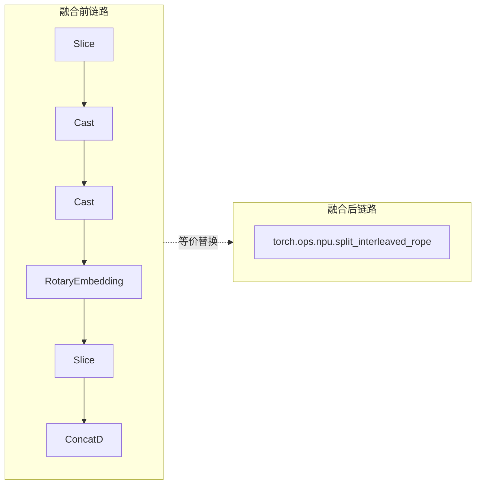

基于 CANNBot Skills 开发 AscendC 融合算子实践

## 1. 摘要

本文以 `torch.ops.npu.split_interleaved_rope` 融合算子为例，总结一次借助 CANNBot Skills 完成 AscendC 融合算子开发的实践过程。目标是将 MLA Decode 链路中的 `Slice + Cast + Cast + RotaryEmbedding + Slice + ConcatD` 融合为单算子实现，并在保证功能正确、GE/非 GE 链路可用的前提下，将耗时从 `32.241us` 优化到 `22.2us`。

## 2. 背景介绍

业务前提：系统要求运行在GE模式下，而GE当前并不支持Triton。因此，这条融合链路无法通过Triton kernel实现，只能采用AscendC自定义算子的方式满足GE编译与执行要求。

在这一前提下，本次实践的核心目标是以 `torch.ops.npu.split_interleaved_rope`替代原有多算子链路，并同时完成GE适配、精度对齐和性能优化。

## 3. CANNBot Skills 介绍和使用

CANNBot Skills 是面向 CANN 开发的可复用技能库，覆盖 AscendC 算子开发、调试、性能分析、文档生成和模型推理优化等场景。其核心价值在于将算子开发中的工程模板、调试方法与性能分析经验沉淀为可复用能力。

### 3.1 适用场景、问题类型

本次实践主要参考以下 Skills：

| Skill | 在本次实践中的作用 |
| --- | --- |
| `ascendc-registry-invoke-template` | 参考自定义算子工程结构、注册方式、OPP/GE 配套和测试组织 |
| `ascendc-tiling-design` | 设计多核切分、Tiling 字段、Buffer 和边界分支 |
| `ascendc-precision-debug` | 构造最小复现、对齐参考实现、定位随机数据下的正确性问题 |
| `ascendc-runtime-debug` | 定位 GE、OPP、环境变量、编译缓存和运行时错误 |
| `ops-profiling` | 使用 msprof 采集性能数据，分析耗时波动和优化效果 |

### 3.2 安装与环境准备

下载 CANNBot Skills：

```bash
git clone https://gitcode.com/cann/cannbot-skills.git
cd cannbot-skills
```

在 Trae 工作区根目录下安装注册算子开发能力：

```bash
bash cannbot-skills/plugins-official/ops-registry-invoke/init.sh project trae
```

安装完成后，Trae 工作区下会生成 `.trae` 配置；若会话中未能自动加载相关 `AGENTS.md` 和 Skills，通常需要检查工作流安装和项目根目录配置是否正确。

若涉及 custom OPP，还需补充：

```bash
export ASCEND_CUSTOM_OPP_PATH=<repo_a_path>/custom_opp/vendors/<vendor_name>
export LD_LIBRARY_PATH=<repo_a_path>/custom_opp/vendors/<vendor_name>/op_proto/lib/<arch>:<repo_a_path>/custom_opp/vendors/<vendor_name>/op_impl/ai_core/tbe/op_tiling/lib/<arch>:/usr/local/lib/python3.9/site-packages/torch_npu/lib:${LD_LIBRARY_PATH:-}
```

这些配置决定了 GE custom op 能否被正确识别、编译和执行。

### 3.3 提示词模板与示例

除按阶段描述任务外，更推荐直接提供“约束明确、可复现、带路径和验收条件”的提示词。结合本次 `split_interleaved_rope` 的开发过程，可将提示词概括为三类。这里重点给出通用模板，后文第 4 章再说明这些模板在实践中如何分阶段落地。

第一类是“提需求”提示词，重点是一次性说明目标函数、参考实现、开发环境和交付要求。例如：

```text
/plan 模式
基于业务仓 B 的测试脚本 B 中的参考函数 _ref_rotary_embedding_remove_padding_interleaved，
在算子仓 A 中开发 Ascend C 融合算子 `torch.ops.npu.split_interleaved_rope`，
融合 torch.split、cast、cat 等小算子，并按仓内既有对标算子的方式完成编译和单测。
```

第二类是“修 bug”提示词，重点是先复现、再定位、再修改。例如：

```text
测试脚本 B 中 `test_split_interleaved_rope_dump_replay` 多次执行结果不稳定，
失败 case 不固定，而参考实现对应测试稳定成功。
请先复现现象，再排查并定位问题。
```

第三类是“问题定位/链路打通”提示词，重点是明确服务脚本、容器、日志和成功标准。例如：

```text
服务脚本 A 在容器环境 A 中执行。
若启动报错，请根据日志定位问题，并在必要时修改算子实现、重新编译安装后再次验证。
启动成功后以客户端请求成功作为最终验收标准，目标是保证 `torch.ops.npu.split_interleaved_rope` 在 GE 模式下可稳定调用。
```

这三类提示词具有共同特征：并非笼统提出“开发一个算子”或“排查一个问题”，而是尽可能显式提供以下信息：

- 目标代码路径
- 参考实现路径
- 容器和运行环境
- 构建、安装、测试命令
- 当前现象和错误日志
- 最终成功标准

这样做的好处在于，Agent 无需额外猜测运行环境和验收口径，可以直接进入可执行状态，将注意力集中在需求分析、问题定位与验证闭环上。

## 4. 算子功能、工程落地与实践过程

`split_interleaved_rope` 的核心功能是融合 `index_q` 的 interleaved RoPE 计算与 NoPE 拼接逻辑。

从功能视角看，原始链路与融合后链路的关系如下：



Python API 形式如下：

```python
torch.ops.npu.split_interleaved_rope(
    index_q_input,
    sin_interleaved,
    cos_interleaved,
    kv_len,
    cumsum_q_len,
    heads,
    bsz,
    q_len,
    index_head_dim,
    qk_rope_head_dim,
)
```

主要输入和约束：

- `index_q_input`：BF16 输入，逻辑形状对应 `[bsz * q_len, heads * index_head_dim]`。
- `sin_interleaved` / `cos_interleaved`：BF16 RoPE 表。
- `kv_len` / `cumsum_q_len`：INT64 序列位置信息。
- `qk_rope_head_dim` 必须为偶数，且不大于 `index_head_dim`。
- 输出 shape 为 `[bsz, q_len, heads, index_head_dim]`。

其融合逻辑如下：

- 将 `index_q_input` 视为 `[bsz, q_len, heads, index_head_dim]`。
- 前 `qk_rope_head_dim` 维作为 PE 部分，执行 interleaved RoPE：

```text
out_even = x_even * cos - x_odd * sin
out_odd  = x_odd  * cos + x_even * sin
```

- 剩余维度作为 NoPE 部分，保持原值并拼接到输出。

工程落地主要包括以下部分：

- PyTorch 自定义算子注册：暴露 `torch.ops.npu.split_interleaved_rope`。
- Host 侧实现：完成输入校验、输出 Tensor 创建和 `OpCommand` 调用。
- AscendC Kernel：实现 RoPE 计算、NoPE copy 和性能分支。
- Tiling/OPP：提供 GE/custom OPP 所需的 tiling、op proto 和配置。
- GE converter：将 PyTorch FX 节点转换为 GE custom op，并固化输出 meta shape。
- 单测：覆盖 eager 随机用例、dump replay 和 GE smoke。

在明确算子功能之后，开发效率的关键转向如何将需求、问题与验证条件准确传递给 Agent。下面结合本次过程，说明如何通过提示词推动任务逐步收敛。

## 5. 精度、GE 与性能问题定位

### 5.1 精度与正确性问题定位

本次精度验证采用两类用例：

- 随机单测：覆盖更泛化的输入，防止只针对真实 dump 做特化。
- 真实 dump replay：覆盖业务实际分布，暴露真实性能特征和边界行为。

早期优化中曾尝试在 `position == 0` 时直接走 identity copy。这个策略在真实 dump 中通常成立，因为真实数据满足：

```text
sin[0] == 0
cos[0] == 1
```

但随机单测中的 `sin_interleaved[0]` 和 `cos_interleaved[0]` 并不一定满足该条件。如果无条件 copy，会导致随机测试下输出与参考实现不一致。

最终修正为“安全 fast path”：

- 仅当 `position == 0`；
- 且 `sin[0]` 全为 0；
- 且 `cos[0]` 全为 1；
- 才走整行 identity copy。

这一过程体现了精度调试中的一个重要经验：真实 dump 有助于定位业务场景中的性能机会，而随机单测能够防止错误的场景特化。

### 5.2 GE 模式与运行时问题定位

在正确性收敛之后，第二个核心挑战转向 GE 模式。由于本次业务必须运行在 GE 下，AscendC 融合算子不仅要“算对”，还必须能够被 GE 正确编译并连接到下游图算子。

本次 GE 模式中最关键的问题是下游 `LightningIndexer` 报错：

```text
Layout BSND, queryDims (0) must be 4!
```

从现象上看，非 GE 模式可以正常运行，而 GE 模式失败。一个自然的问题是：融合算子在 GE 与非 GE 下的输出 shape 是否存在差异？

实际结论是：

- eager 模式下，算子运行时可以直接创建真实输出 Tensor，shape 是 `[bsz, q_len, heads, index_head_dim]`。
- GE 模式下，下游 `LightningIndexer` 在编译期依赖上游节点的 TensorDesc/meta shape。
- 如果 `SplitInterleavedRope` 的 GE custom op 没有把输出 rank 和 shape 正确传下去，下游看到的 `queryDims` 就可能是 0。

修复方式是在 `ge_converters.py` 中：

- 注册 `torch.ops.npu.split_interleaved_rope` 的 FX-to-GE converter。
- 创建 GE custom op `SplitInterleavedRope`。
- 使用 `meta_outputs` 设置输出 meta。
- 必要时通过 `Reshape` 固化输出 shape，使下游看到 rank 4。

此外，运行时还需要关注安装与环境问题：

- `ASCEND_CUSTOM_OPP_PATH` 要指向当前算子仓的 custom OPP vendor 目录。
- `LD_LIBRARY_PATH` 要包含 op proto、op tiling 和 `torch_npu/lib`。
- wheel 安装后通常不需要再把源码 Python 目录加入 `PYTHONPATH`。
- 同版本 wheel 可能不会自动覆盖，需要 `--force-reinstall --no-deps`。
- TBE/GE 编译缓存可能复用旧 kernel，必要时清理 `/root/atc_data` 中相关缓存。

这些问题都适合沿用 `ascendc-runtime-debug` 的处理思路：先确认错误码与日志，再逐项核对环境变量、安装路径、OPP 路径和编译缓存。

### 5.3 性能优化与验证

GE 路径打通之后，问题才真正进入性能阶段。此时分析重点由“能否跑通”转向“性能瓶颈在哪里、还能否继续优化”。

融合前后链路如下：

```text
Slice + Cast + Cast + RotaryEmbedding + Slice + ConcatD
    ↓
torch.ops.npu.split_interleaved_rope
```

优化收益：

```text
32.241us -> 22.2us
```

主要收益来源包括：

- 多算子融合，减少调度和中间 Tensor 开销。
- 在单个 kernel 内完成 PE RoPE 计算和 NoPE 拼接。
- NoPE 部分使用更高效的连续 copy。
- 对 `position == 0` 且 `sin[0]/cos[0]` 满足 identity 的场景走安全 fast path。

在性能分析过程中，`ops-profiling` 类 Skill 的价值主要体现在两点：

- 用 msprof 数据确认问题，而不是只凭代码推测瓶颈。
- 用优化前后数据闭环验证收益。

本次 profile 结果表明，融合算子不仅降低了原多算子链路的整体耗时，也使性能问题能够集中到单个 kernel 内分析。

在功能、GE 和性能三个层面形成闭环之后，便可以进一步回看这次开发带来的实际价值，并总结可复用的方法。
