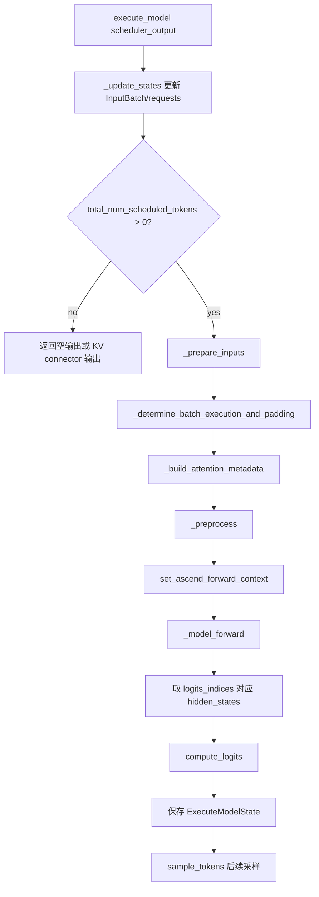
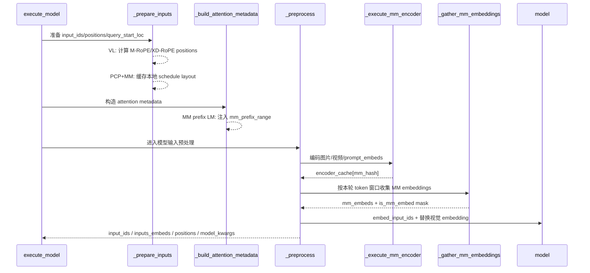

# `model_runner_v1.py` 调用流程与 `_prepare_inputs` 逻辑

本文梳理 `vllm_ascend/worker/model_runner_v1.py` 中 `NPUModelRunner` 的推理调用链，重点说明 `_prepare_inputs()` 如何准备本轮 forward 的 token、position、attention 输入，以及 VL/多模态模型在这条链路上的处理方式。

## 总体流程

`execute_model()` 是一次模型执行的主入口。它先把 scheduler 的输出写入 runner 的持久 batch 状态，然后调用 `_prepare_inputs()` 准备本轮 token 级输入；随后构造 attention metadata，再进入 `_preprocess()` 处理多模态 embedding，最后执行模型 forward 和 logits 计算。



关键代码位置：

```python
# model_runner_v1.py
deferred_state_corrections_fn = self._update_states(scheduler_output)

tokens = [scheduler_output.num_scheduled_tokens[i]
          for i in self.input_batch.req_ids]
num_scheduled_tokens_np = np.array(tokens, dtype=np.int32)

(logits_indices,
 spec_decode_metadata,
 total_num_scheduled_tokens,
 num_scheduled_tokens_compressed_list) = self._prepare_inputs(
     scheduler_output,
     num_scheduled_tokens_np,
)

(attn_metadata, spec_decode_common_attn_metadata) = \
    self._build_attention_metadata(...)

(input_ids, inputs_embeds, positions, intermediate_tensors,
 model_kwargs, ec_connector_output) = self._preprocess(...)
```

可以把这条链路理解成三层：

- `_update_states()`：把调度结果写入 `InputBatch`，例如请求顺序、token 表、block table、采样元数据等。
- `_prepare_inputs()`：根据本轮每个请求要算多少 token，展开成 token 级数组，并准备 `input_ids`、`positions`、`query_start_loc`、`seq_lens`、`slot_mapping`、`logits_indices`。
- `_preprocess()`：基于 `_prepare_inputs()` 已确定的顺序，补齐模型真正需要的输入形式。VL 模型通常在这里把文字 token 和视觉 embedding 统一成 `inputs_embeds`。

## `_prepare_inputs` 分段逻辑

### 1. 建立本轮 token 布局

函数入口拿到的是 request 级的 `num_scheduled_tokens`，例如 3 个请求分别调度 `[2, 1, 4]` 个 token。第一步会把 request 级信息展开成 token 级的 `req_indices`：

```python
total_num_scheduled_tokens = scheduler_output.total_num_scheduled_tokens
num_reqs = self.input_batch.num_reqs

self.input_batch.block_table.commit_block_table(num_reqs)

req_indices = np.repeat(self.arange_np[:num_reqs],
                        num_scheduled_tokens)
```

`req_indices` 表示每个展开后的 token 属于哪个请求。比如 `[2, 1, 4]` 会展开成 `[0, 0, 1, 2, 2, 2, 2]`。后续计算 `positions`、取 token id、写 KV cache slot 都依赖这个展开顺序。

接着根据是否包含 speculative decode token 计算 `num_valid_tokens`，并判断本轮 attention 状态：

```python
if not scheduler_output.scheduled_spec_decode_tokens:
    num_valid_tokens = num_scheduled_tokens
else:
    num_valid_tokens = np.array([
        scheduler_output.num_scheduled_tokens[i]
        - len(scheduler_output.scheduled_spec_decode_tokens.get(i, []))
        for i in self.input_batch.req_ids
    ], dtype=np.int32)

attn_state = self._build_attn_state(
    num_reqs, num_scheduled_tokens, num_valid_tokens)
with_prefill = attn_state not in [
    AscendAttentionState.DecodeOnly,
    AscendAttentionState.SpecDecoding,
]
```

这里的 `attn_state` 会区分 `PrefillNoCache`、`DecodeOnly`、`SpecDecoding`、`ChunkedPrefill`、`PrefillCacheHit` 等场景，后面 attention metadata builder 会消费这个状态。

### 2. 计算 position 和 `query_start_loc`

`_get_cumsum_and_arange()` 同时生成两类数据：

- `cu_num_tokens`：每个请求调度 token 数的前缀和，例如 `[2, 3, 7]`。
- `self.query_pos.np`：每个请求内部的相对位置，例如 `[0, 1, 0, 0, 1, 2, 3]`。

随后用请求已经计算过的 token 数加上相对位置，得到本轮每个 token 的绝对 position：

```python
cu_num_tokens = self._get_cumsum_and_arange(
    num_scheduled_tokens, self.query_pos.np)

positions_np = self._positions_np_buf[:total_num_scheduled_tokens]
np.add(
    self.input_batch.num_computed_tokens_cpu[req_indices],
    self.query_pos.np[:cu_num_tokens[-1]],
    out=positions_np,
)

self.query_start_loc.np[0] = 0
self.query_start_loc.np[1:num_reqs + 1] = cu_num_tokens
self.query_start_loc.copy_to_gpu()
```

通俗地说：`query_pos` 是“本轮请求内部第几个 token”，`num_computed_tokens_cpu` 是“这个请求之前已经算到哪里”，两者相加就是模型 RoPE/KV cache 需要的全局序列位置。

### 3. PCP 场景会改写本地 token 布局

当 `pcp_size > 1` 时，同一个长 prefill 可能被不同 PCP rank 切分处理。此时 `_prepare_inputs()` 先用 PCP 切分前的 position 在 GPU 上计算 slot mapping，然后让 `pcp_manager` 改写本 rank 实际要处理的 token 数和 position：

```python
if self.pcp_size > 1:
    pre_pcp_positions = torch.from_numpy(
        positions_np[:total_num_scheduled_tokens]).to(self.device)
    pre_pcp_qsl = torch.zeros(num_reqs + 1, dtype=torch.int32,
                              device=self.device)
    pre_pcp_qsl[1:num_reqs + 1] = torch.from_numpy(cu_num_tokens).to(
        dtype=torch.int32, device=self.device)
    self.input_batch.block_table.compute_slot_mapping(
        num_reqs, pre_pcp_qsl, pre_pcp_positions)

    num_scheduled_tokens[:num_reqs], position_pcp = \
        self.pcp_manager.update_tokens_for_pcp(
            num_scheduled_tokens[:num_reqs], self.arange_np)
```

PCP 改写之后，会重新计算 `total_num_scheduled_tokens`、`req_indices`、`cu_num_tokens` 和 `positions_np`。因此后面所有 token 级输入都以本地 PCP 布局为准。

### 4. 取出 `input_ids`，并处理 prompt embedding

`token_indices` 是从二维 token 表拉平成一维后的索引：

```python
token_indices = (
    positions_np
    + req_indices * self.input_batch.token_ids_cpu.shape[1]
)

torch.index_select(
    self.input_batch.token_ids_cpu_tensor.flatten(),
    0,
    torch.from_numpy(token_indices),
    out=self.input_ids.cpu[:total_num_scheduled_tokens],
)
```

可以理解成：`InputBatch.token_ids_cpu` 是 `[request, position]` 二维表，`token_indices` 把本轮调度到的 token 从表里按 forward 顺序取出来，写入连续的 `self.input_ids`。

如果请求携带 `prompt_embeds`，`NPUInputBatch` 不会预先分配一个巨大的 embedding 表，而是用 `req_prompt_embeds: dict[int, Tensor]` 按请求存储。这里按本轮 schedule 的位置拷贝到 runner 的 `inputs_embeds` 缓冲区：

```python
if self.input_batch.req_prompt_embeds and (
    self.is_multimodal_model or self.enable_prompt_embeds
):
    for req_idx in range(num_reqs):
        req_embeds = self.input_batch.req_prompt_embeds[req_idx]
        start_pos = self.input_batch.num_computed_tokens_cpu[req_idx]
        end_pos = start_pos + num_sched
        self.inputs_embeds.cpu[output_idx:output_idx + actual_num_sched].copy_(
            req_embeds[start_pos:actual_end])
```

这里处理的是已经在 embedding 空间里的 prompt embedding。普通图片/视频的视觉 encoder 不在 `_prepare_inputs()` 中执行，而是在后面的 `_preprocess()` 中执行。

最后调用父类 `_prepare_input_ids()` 把 CPU 侧准备好的输入拷贝到 NPU；异步调度场景下，它还会把上一轮采样出的 token 从 `prev_sampled_token_ids` 直接在 GPU/NPU 侧补到当前位置。

```python
self._prepare_input_ids(
    scheduler_output, num_reqs,
    total_num_scheduled_tokens, cu_num_tokens)
```

### 5. VL 位置编码：M-RoPE / XD-RoPE

VL 模型最直接出现在 `_prepare_inputs()` 的逻辑是位置编码。比如 Qwen2-VL 这类使用 M-RoPE 的模型，position 不是普通的一维 token position，而是多维位置：

```python
if self.uses_mrope:
    self._calc_mrope_positions(scheduler_output)
    if self.pcp_size > 1:
        self.pcp_manager.remap_mrope_positions_for_pcp(
            positions_np,
            num_scheduled_tokens,
            num_reqs,
            self.input_batch,
            self.requests,
            self.mrope_positions,
        )
    self.mrope_positions.gpu.copy_(self.mrope_positions.cpu,
                                   non_blocking=True)
elif self.uses_xdrope_dim > 0:
    self._calc_xdrope_positions(scheduler_output)
    self.xdrope_positions.gpu[:, :total_num_scheduled_tokens].copy_(
        self.xdrope_positions.cpu[:, :total_num_scheduled_tokens],
        non_blocking=True,
    )
```

父类 `_calc_mrope_positions()` 的核心思路是：

- prompt 部分：使用 request 上预先计算好的 `req.mrope_positions`。
- completion 部分：根据 `mrope_position_delta` 和当前上下文长度现场生成后续位置。

这就是 VL 模型在 `_prepare_inputs()` 中的关键差异：普通文本模型只需要 `self.positions` 一维位置；VL 模型可能需要 `self.mrope_positions` 或 `self.xdrope_positions`，并且 PCP 切分后还要重新映射到本 rank 的 token 布局。

异步 speculative decode 下，GPU 侧的 `num_computed_tokens` 可能被接受 token 数修正。若模型使用 M-RoPE/XD-RoPE，还要给位置加上这个 drift：

```python
if self.use_async_spec_decode and (
    self.uses_mrope or self.uses_xdrope_dim > 0
):
    drift = self.num_computed_tokens[req_indices_gpu].to(torch.int64) \
        - self.input_batch.num_computed_tokens_cpu_tensor[req_indices].to(
            device=self.device, dtype=torch.int64, non_blocking=True)
    target = self.mrope_positions if self.uses_mrope else self.xdrope_positions
    target.gpu[:, :total_num_scheduled_tokens] += drift
```

### 6. 更新 seq lens、slot mapping 和压缩 KV 信息

`_prepare_inputs()` 会把 request 级和 token 级的辅助张量都同步到 NPU：

```python
self.req_indices.np[:total_num_scheduled_tokens] = req_indices
self.req_indices.copy_to_gpu(total_num_scheduled_tokens)

self.query_pos.copy_to_gpu(total_num_scheduled_tokens)
self.num_scheduled_tokens.np[:num_reqs] = num_scheduled_tokens
self.num_scheduled_tokens.copy_to_gpu(num_reqs)

self.positions[:total_num_scheduled_tokens] = (
    self.num_computed_tokens[req_indices_gpu].to(torch.int64)
    + self.query_pos.gpu[:total_num_scheduled_tokens]
)
self.seq_lens[:num_reqs] = (
    self.num_computed_tokens[:num_reqs] + num_scheduled_tokens_gpu
)
```

非 PCP 场景下，slot mapping 在这里根据 `query_start_loc` 和 `positions` 计算：

```python
if self.pcp_size <= 1:
    self.input_batch.block_table.compute_slot_mapping(
        num_reqs,
        self.query_start_loc.gpu[:num_reqs + 1],
        self.positions[:total_num_scheduled_tokens],
        positions_compressed_list,
        req_indices_compressed_list,
    )
```

如果启用了 DSV4 等压缩 KV cache，还会通过 `get_compressed_pos_and_indices()` 生成压缩后的 position、request index 和 scheduled token 数，供后续 `_build_attention_metadata()` 选择对应 KV group 的 block table 和 slot mapping。

### 7. 计算 `logits_indices` 和 speculative decode metadata

没有 speculative decode 时，每个请求只需要取最后一个 token 的 hidden state 去算 logits：

```python
if not use_spec_decode:
    spec_decode_metadata = None
    num_sampled_tokens = np.ones(num_reqs, dtype=np.int32)
    logits_indices = self.query_start_loc.gpu[1:num_reqs + 1] - 1
```

有 speculative decode 时，需要同时取 target token 和 draft token 对应的 logits，并构造 `SpecDecodeMetadata`：

```python
num_draft_tokens = np.zeros(num_reqs, dtype=np.int32)
for req_id, draft_token_ids in \
        scheduler_output.scheduled_spec_decode_tokens.items():
    req_idx = self.input_batch.req_id_to_index[req_id]
    num_draft_tokens[req_idx] = len(draft_token_ids)

spec_decode_metadata = self._calc_spec_decode_metadata(
    num_draft_tokens,
    cu_num_tokens,
    num_pcp_pads=...,
)
logits_indices = spec_decode_metadata.logits_indices
num_sampled_tokens = num_draft_tokens + 1
```

最后，如果开启 LoRA，会根据本轮要采样的 token 数设置 active LoRA；如果开启 lmhead tensor parallel，会对 `logits_indices` 做 padding。

## VL 模型的完整处理链路

严格地说，`_prepare_inputs()` 不执行图片/视频 encoder，也不在这里把视觉特征塞进模型输入。它为 VL 做了三件前置工作：

1. 按当前 batch/PCP 布局准备 `input_ids`、`positions`、`query_start_loc`。
2. 为 M-RoPE/XD-RoPE 模型准备多维 position。
3. PCP + MM 场景下缓存本地 schedule layout，供后续 `_preprocess()` 以本 rank 的 token 布局做多模态拼接。

```python
if (
    self.pcp_size > 1
    and self.supports_mm_inputs
    and get_pp_group().is_first_rank
    and not self.model_config.is_encoder_decoder
):
    self.pcp_manager.cache_local_schedule_layout(
        num_scheduled_tokens=num_scheduled_tokens,
        num_reqs=base_num_reqs,
        total_num_scheduled_tokens=total_num_scheduled_tokens,
    )
```

后续 `_preprocess()` 才进入真正的 VL embedding 路径。它发生在 `_build_attention_metadata()` 之后、`_model_forward()` 之前，此时 `_prepare_inputs()` 已经确定了本轮 token 的扁平顺序、position、`query_start_loc` 和 `input_ids`。这点很重要：多模态 embedding 必须按照同一套扁平 token 顺序写入 `inputs_embeds`，否则视觉 token 会和文本上下文错位。

### `_preprocess` 的上下文和分支

Ascend 这里覆写 `_preprocess()`，主要是为 PCP + MM 临时本地化 `scheduler_output`，然后复用父类逻辑：

```python
restore_state = self.pcp_manager.maybe_localize_scheduler_output_for_mm_preprocess(
    scheduler_output=scheduler_output,
    req_ids=self.input_batch.req_ids,
    requests=self.requests,
    positions_np=positions_np,
    local_num_scheduled_tokens=local_num_sched,
    local_total_num_scheduled_tokens=local_total,
    encoder_cache=self.encoder_cache,
)

try:
    return super()._preprocess(
        scheduler_output, num_input_tokens, intermediate_tensors)
finally:
    self.pcp_manager.restore_scheduler_output_after_mm_preprocess(
        scheduler_output, restore_state)
```

父类 `_preprocess()` 入口先判断三个上下文条件：

```python
num_scheduled_tokens = scheduler_output.total_num_scheduled_tokens
is_first_rank = get_pp_group().is_first_rank
is_encoder_decoder = self.model_config.is_encoder_decoder

if self.supports_mm_inputs and is_first_rank and not is_encoder_decoder:
    ...
elif self.enable_prompt_embeds and is_first_rank:
    ...
else:
    ...
```

对普通 decoder-only VL 模型，走第一个分支。它把文本 token embedding 和视觉 embedding 统一写入同一个 `inputs_embeds`：

```python
if self.supports_mm_inputs and is_first_rank and not is_encoder_decoder:
    with self.maybe_get_ec_connector_output(
        scheduler_output,
        encoder_cache=self.encoder_cache,
    ) as ec_connector_output:
        self._execute_mm_encoder(scheduler_output)
        mm_embeds, is_mm_embed = self._gather_mm_embeddings(scheduler_output)

    inputs_embeds_scheduled = self.model.embed_input_ids(
        self.input_ids.gpu[:num_scheduled_tokens],
        multimodal_embeddings=mm_embeds,
        is_multimodal=is_mm_embed,
    )
    self.inputs_embeds.gpu[:num_scheduled_tokens].copy_(
        inputs_embeds_scheduled)

    input_ids, inputs_embeds = self._prepare_mm_inputs(num_input_tokens)
    model_kwargs = {
        **self._init_model_kwargs(),
        **self._extract_mm_kwargs(scheduler_output),
    }
```

这段逻辑可以理解为：

- `_execute_mm_encoder()`：把 scheduler 指定的图片/视频等 encoder input 送入 `model.embed_multimodal()`，输出缓存到 `encoder_cache[mm_hash]`。
- `_gather_mm_embeddings()`：按 `_prepare_inputs()` 已确定的 token 顺序，找出本轮窗口内哪些 token 是多模态占位符，并从 `encoder_cache` 抽取对应 embedding。
- `model.embed_input_ids()`：先把文本 token id 走 embedding 层，再用 `is_mm_embed` mask 把视觉位置替换成视觉 embedding。
- `_prepare_mm_inputs()`：大多数 VL 模型返回 `input_ids=None, inputs_embeds=...`；如果模型 `requires_raw_input_tokens`，也会把 raw `input_ids` 一并传入。

随后 `_preprocess()` 选择 position。VL 模型如果使用 M-RoPE/XD-RoPE，就不会使用普通一维 `self.positions`：

```python
if self.uses_mrope:
    positions = self.mrope_positions.gpu[:, :num_input_tokens]
elif self.uses_xdrope_dim > 0:
    positions = self.xdrope_positions.gpu[:, :num_input_tokens]
else:
    positions = self.positions[:num_input_tokens]
```

最终 `_preprocess()` 返回：

```python
return (
    input_ids,
    inputs_embeds,
    positions,
    intermediate_tensors,
    model_kwargs,
    ec_connector_output,
)
```

因此，对大多数 decoder-only VL 模型，进入 `_model_forward()` 前的输入形态是：

- `input_ids = None`，除非模型声明 `requires_raw_input_tokens`。
- `inputs_embeds = self.inputs_embeds.gpu[:num_input_tokens]`，文本 token 和视觉 token 都已经在这个张量里。
- `positions = self.mrope_positions / self.xdrope_positions / self.positions` 中的一种。
- `model_kwargs` 带上基础 kwargs 和 `_extract_mm_kwargs(scheduler_output)` 提取出的多模态相关参数。



### `_gather_mm_embeddings` 如何按窗口抽取视觉 embedding

父类逻辑会遍历每个 request 的 `mm_features`，只处理落在本轮 `[num_computed_tokens, num_computed_tokens + num_scheduled_tokens)` 窗口内的多模态特征：

```python
lo, hi = get_mm_features_in_window(
    mm_features,
    start=num_computed_tokens,
    end=num_computed_tokens + num_scheduled_tokens,
)

for i in range(lo, hi):
    mm_feature = mm_features[i]
    pos_info = mm_feature.mm_position
    encoder_output = self.encoder_cache[mm_feature.identifier]

    curr_embeds_start, curr_embeds_end = \
        pos_info.get_embeds_indices_in_range(start_idx, end_idx)
    mm_embeds_item = encoder_output[curr_embeds_start:curr_embeds_end]

    is_mm_embed[flat_start:flat_end] = True
    mm_embeds_req.append(mm_embeds_item)
```

这个 mask 很关键：文本 token 和视觉 token 最终都在同一个 `inputs_embeds` 张量里，`is_mm_embed` 指出哪些位置要用 `mm_embeds` 替换，而不是用普通 token embedding。

`_execute_mm_encoder()` 则负责让 `encoder_cache` 中真的有这些 embedding。它先从 scheduler 输出中拿到本轮需要编码的多模态输入：

```python
scheduled_encoder_inputs = scheduler_output.scheduled_encoder_inputs
for req_id, encoder_input_ids in scheduled_encoder_inputs.items():
    req_state = self.requests[req_id]
    for mm_input_id in encoder_input_ids:
        mm_feature = req_state.mm_features[mm_input_id]
        mm_hashes.append(mm_feature.identifier)
        mm_kwargs.append((mm_feature.modality, mm_feature.data))
```

然后按 modality 分组调用模型的多模态 encoder，并按 `mm_hash` 缓存输出：

```python
for modality, num_items, mm_kwargs_batch in group_and_batch_mm_kwargs(...):
    batch_outputs = model.embed_multimodal(**mm_kwargs_batch)
    encoder_outputs.extend(batch_outputs)

for mm_hash, output in zip(mm_hashes, encoder_outputs):
    self.encoder_cache[mm_hash] = output
```

`prompt_embeds` 是特殊 passthrough modality，它已经是模型 embedding 空间里的张量，不需要跑 encoder，会直接写入 `encoder_cache`，后续也通过相同的 `_gather_mm_embeddings()` 路径拼接。

Ascend 在 PCP 场景重写了 `_gather_mm_embeddings()`，核心差异是使用 `_prepare_inputs()` 缓存的本地 schedule layout：

```python
local_num_scheduled_tokens, _ = self.pcp_manager.get_local_schedule_layout()
...
mm_embeds, should_sync_mrope_positions, should_sync_xdrope_positions = \
    self.pcp_manager.gather_mm_embeddings_for_pcp(
        req_ids=self.input_batch.req_ids,
        requests=self.requests,
        positions_np=positions_np,
        local_num_scheduled_tokens=local_num_scheduled_tokens,
        encoder_cache=self.encoder_cache,
        is_mm_embed=is_mm_embed,
        uses_mrope=self.uses_mrope,
    )
```

如果多模态 pruning 或 PCP 处理导致 M-RoPE/XD-RoPE position 需要变化，这里会重新计算并同步到 NPU。

### 完整例子：文本 token 和视觉 token 如何合并

假设一个 decoder-only VL 请求 `reqA`，没有 PCP，没有 speculative decode，当前是 prefill，`num_computed_tokens = 0`，本轮调度 6 个 token。模型处理器已经把图片占位展开成 3 个视觉占位 token：

| 扁平位置 | 原始含义 | `input_ids` 中的内容 | 最终 `inputs_embeds` |
| --- | --- | --- | --- |
| 0 | BOS | `T_BOS` | `Emb(T_BOS)` |
| 1 | 文本“描述” | `T_text_0` | `Emb(T_text_0)` |
| 2 | 图片 patch 0 占位 | `T_img_placeholder` | `E_img[0]` |
| 3 | 图片 patch 1 占位 | `T_img_placeholder` | `E_img[1]` |
| 4 | 图片 patch 2 占位 | `T_img_placeholder` | `E_img[2]` |
| 5 | 文本“内容” | `T_text_1` | `Emb(T_text_1)` |

这个例子中的 request 状态大致是：

```python
self.input_batch.req_ids = ["reqA"]
scheduler_output.num_scheduled_tokens = {"reqA": 6}
scheduler_output.scheduled_encoder_inputs = {"reqA": [0]}

req_state.mm_features[0].identifier = "img_hash_0"
req_state.mm_features[0].modality = "image"
req_state.mm_features[0].mm_position.offset = 2
req_state.mm_features[0].mm_position.length = 3
```

第一步，`_prepare_inputs()` 只按 token 表取出本轮的 token id。视觉位置此时仍然只是 placeholder token id：

```python
req_indices = [0, 0, 0, 0, 0, 0]
positions_np = [0, 1, 2, 3, 4, 5]
self.input_ids.cpu[:6] = [
    T_BOS,
    T_text_0,
    T_img_placeholder,
    T_img_placeholder,
    T_img_placeholder,
    T_text_1,
]
```

如果这是 Qwen2-VL 这类 M-RoPE 模型，`_prepare_inputs()` 同时会准备：

```python
self._calc_mrope_positions(scheduler_output)
self.mrope_positions.gpu.copy_(self.mrope_positions.cpu, non_blocking=True)
```

第二步，`_preprocess()` 运行视觉 encoder。`_execute_mm_encoder()` 从 `scheduled_encoder_inputs` 找到 `reqA` 的第 0 个多模态输入，调用：

```python
encoder_outputs = model.embed_multimodal(image=...)
self.encoder_cache["img_hash_0"] = encoder_outputs[0]  # shape: [3, hidden_size]
```

第三步，`_gather_mm_embeddings()` 根据当前调度窗口 `[0, 6)` 和 `mm_position.offset = 2, length = 3` 计算交集，得到：

```python
mm_embeds = [self.encoder_cache["img_hash_0"][0:3]]
is_mm_embed = [False, False, True, True, True, False]
```

第四步，`model.embed_input_ids()` 先对所有 `input_ids` 做文本 embedding，再用 `is_mm_embed` 将第 2、3、4 行替换成视觉 encoder 输出：

```python
inputs_embeds_scheduled = self.model.embed_input_ids(
    self.input_ids.gpu[:6],
    multimodal_embeddings=mm_embeds,
    is_multimodal=is_mm_embed,
)

self.inputs_embeds.gpu[:6].copy_(inputs_embeds_scheduled)
```

最终进入 `_model_forward()` 的不是“文本 token id + 单独的视觉 token”，而是一条统一的 embedding 序列：

```text
inputs_embeds[0] = Emb(T_BOS)
inputs_embeds[1] = Emb(T_text_0)
inputs_embeds[2] = E_img[0]
inputs_embeds[3] = E_img[1]
inputs_embeds[4] = E_img[2]
inputs_embeds[5] = Emb(T_text_1)
```

如果图模式或 DP/SP padding 让 `num_input_tokens > num_scheduled_tokens`，`_prepare_mm_inputs(num_input_tokens)` 返回的是带 padding 长度的 `inputs_embeds` slice；真实有效 token 仍由 attention metadata 中的 `num_actual_tokens`、`query_start_loc`、`seq_lens` 等约束。

### VL 模型完整函数调用栈

下面的调用栈按 `execute_model()` 的真实顺序整理。`_model_forward()` 之前详细展开，之后只保留粗粒度流程。

```text
NPUModelRunner.execute_model(scheduler_output)
  ├─ _update_states(scheduler_output)
  │    └─ 更新 self.input_batch / self.requests / block_table / sampling_metadata
  ├─ _prepare_inputs(scheduler_output, num_scheduled_tokens_np)
  │    ├─ block_table.commit_block_table(num_reqs)
  │    ├─ 展开 req_indices，计算 cu_num_tokens / query_pos / positions_np
  │    ├─ _build_attn_state(...)
  │    ├─ PCP: update_tokens_for_pcp(...) 并重算本地 token 布局
  │    ├─ 从 token_ids_cpu_tensor 按 token_indices 取 self.input_ids.cpu
  │    ├─ prompt_embeds: 拷贝到 self.inputs_embeds.cpu 对应位置
  │    ├─ _prepare_input_ids(...)
  │    │    └─ 将 input_ids / inputs_embeds / is_token_ids 拷贝到 NPU
  │    ├─ VL position:
  │    │    ├─ uses_mrope: _calc_mrope_positions(...)
  │    │    └─ uses_xdrope_dim > 0: _calc_xdrope_positions(...)
  │    ├─ 更新 discard_request_indices / num_accepted_tokens
  │    ├─ 更新 num_computed_tokens / req_indices / query_pos / seq_lens
  │    ├─ compute_slot_mapping(...) 或使用 PCP 预计算 slot_mapping
  │    ├─ speculative decode: _calc_spec_decode_metadata(...)
  │    └─ PCP + MM: cache_local_schedule_layout(...)
  ├─ _determine_batch_execution_and_padding(...)
  │    └─ 得到 cudagraph_mode / batch_desc / num_tokens_padded
  ├─ 可选: mamba_utils.preprocess_mamba(...)
  ├─ _build_attention_metadata(...)
  │    ├─ 构造 AscendCommonAttentionMetadata
  │    ├─ 为每个 KV cache group / attention group 调 builder.build(...)
  │    └─ is_mm_prefix_lm: 写入 attn_metadata[*].mm_prefix_range
  ├─ _preprocess(scheduler_output, num_input_tokens, intermediate_tensors)
  │    ├─ Ascend PCP + MM:
  │    │    ├─ get_local_schedule_layout()
  │    │    └─ maybe_localize_scheduler_output_for_mm_preprocess(...)
  │    ├─ super()._preprocess(...)
  │    │    ├─ VL decoder-only 分支:
  │    │    │    ├─ _execute_mm_encoder(...)
  │    │    │    │    ├─ _batch_mm_inputs_from_scheduler(...)
  │    │    │    │    ├─ model.embed_multimodal(...)
  │    │    │    │    └─ encoder_cache[mm_hash] = encoder_output
  │    │    │    ├─ _gather_mm_embeddings(...)
  │    │    │    │    ├─ get_mm_features_in_window(...)
  │    │    │    │    ├─ 从 encoder_cache 取 mm_embeds
  │    │    │    │    └─ 生成 is_mm_embed mask
  │    │    │    ├─ model.embed_input_ids(
  │    │    │    │      input_ids, multimodal_embeddings, is_multimodal)
  │    │    │    ├─ self.inputs_embeds.gpu[:num_scheduled_tokens].copy_(...)
  │    │    │    ├─ _prepare_mm_inputs(num_input_tokens)
  │    │    │    └─ model_kwargs = _init_model_kwargs() + _extract_mm_kwargs(...)
  │    │    ├─ 选择 positions: mrope / xdrope / normal positions
  │    │    └─ PP 非首 rank: sync_and_gather_intermediate_tensors(...)
  │    └─ Ascend PCP + MM: restore_scheduler_output_after_mm_preprocess(...)
  ├─ update_cos_sin(positions)
  ├─ set_ascend_forward_context(attn_metadata, ...)
  ├─ maybe_get_kv_connector_output(...)
  └─ _model_forward(num_tokens_padded, input_ids, positions,
                   intermediate_tensors, inputs_embeds, **model_kwargs)

_model_forward 之后:
  ├─ 得到 hidden_states
  ├─ PCP: restore hidden_states
  ├─ PP/pooling 分支处理
  ├─ sample_hidden_states = hidden_states[logits_indices]
  ├─ logits = model.compute_logits(sample_hidden_states)
  ├─ 保存 ExecuteModelState
  └─ sample_tokens(): grammar mask / sampler / bookkeeping / speculative draft
```

### MM prefix LM 的 attention 补充

对于 `model_config.is_mm_prefix_lm`，attention metadata 还会记录每个请求中多模态 embedding 的区间：

```python
if self.is_mm_prefix_lm:
    req_doc_ranges = {}
    for req_id in self.input_batch.req_ids:
        image_doc_ranges = []
        req_state = self.requests[req_id]
        for mm_feature in req_state.mm_features:
            pos_info = mm_feature.mm_position
            image_doc_ranges.extend(pos_info.extract_embeds_range())

        req_idx = self.input_batch.req_id_to_index[req_id]
        req_doc_ranges[req_idx] = image_doc_ranges

    for _metadata in attn_metadata.values():
        _metadata.mm_prefix_range = req_doc_ranges
```

这不是 embedding 替换，而是把“哪些 token range 属于多模态前缀”告诉 attention backend，便于对应 backend 使用 MM prefix 相关优化或特殊处理。

## 小结

- `_prepare_inputs()` 的主职责是把 scheduler 的 request 级计划展开成 NPU forward 所需的 token 级输入布局。
- 普通文本模型主要消费 `input_ids + positions`；VL 模型通常消费 `inputs_embeds + M-RoPE/XD-RoPE positions`。
- 图片/视频 encoder 不在 `_prepare_inputs()` 里跑，而是在 `_preprocess()` 中通过 `_execute_mm_encoder()` 和 `_gather_mm_embeddings()` 完成。
- `_prepare_inputs()` 对 VL 最重要的贡献是：先确定 token 顺序和 position，再为 M-RoPE/XD-RoPE、PCP + MM、本地多模态窗口抽取提供一致的布局基础。
- `is_mm_prefix_lm` 的额外处理发生在 `_build_attention_metadata()`，它把多模态 prefix range 附加到 attention metadata，而不是改变模型输入 embedding。
