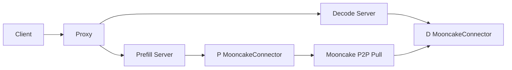
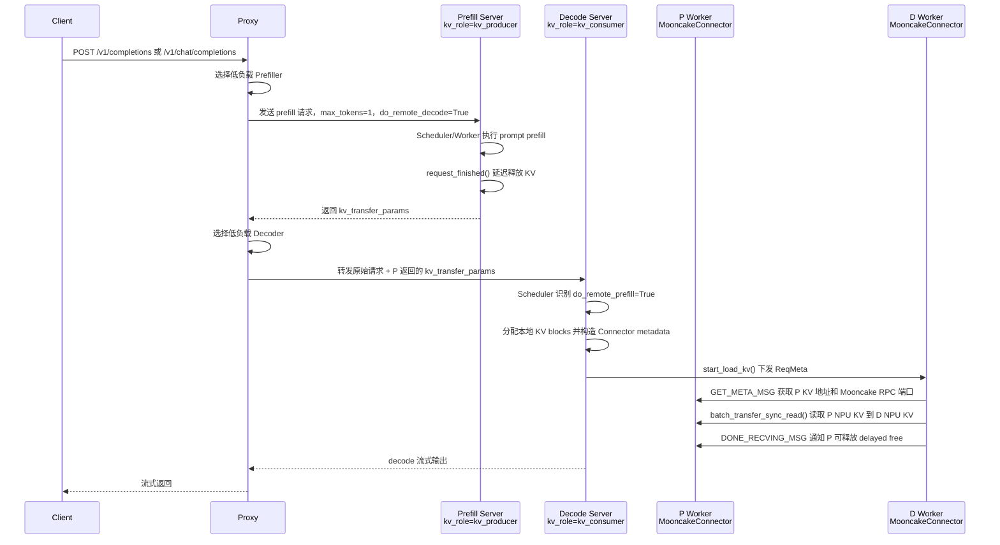

# 基于 MooncakeConnector 的 PD 分离处理流程

## 1. 背景与范围

大模型在线推理中，prefill 偏向长 prompt 的集中计算和 KV Cache 写入，decode 偏向逐 token 生成的低延迟和持续吞吐。PD 分离将两类负载拆到不同 vLLM server，便于业务独立扩缩 P/D 节点，降低长 prompt 对 decode 延迟的影响，并通过远端 KV Cache 复用避免重复 prefill。

本文范围限定为 vLLM Ascend NPU 硬件下的在线 PD 分离流程：P 节点生成并短暂保留 KV Cache，D 节点通过 MooncakeConnector 从 P 侧 NPU 显存拉取 KV 后继续 decode，Proxy 负责请求编排和 P/D 负载选择。KV 传输仅讨论 `MooncakeConnectorV1` / `MooncakeConnector`，不展开 NIXL、GPU connector、layerwise proxy 或其他 connector。

## 2. 总体架构

### 2.1 简化总体架构图



### 2.2 端到端时序

在线 PD 分离链路中，Client 只感知 Proxy 暴露的 OpenAI 兼容接口；Proxy 负责请求编排和 P/D 负载选择；Prefill Server 以 `kv_role=kv_producer` 运行，Decode Server 以 `kv_role=kv_consumer` 运行；P/D 节点内部由 vLLM scheduler 调用 KV Connector 接口，由 worker 侧通过 ZMQ side channel 和 Mooncake TransferEngine 完成 NPU KV Cache 地址交换与传输。



关键关系：

- Proxy 不直接搬运 KV Cache，只负责 HTTP 请求编排、P/D 实例选择和 `kv_transfer_params` 透传。
- P/D 节点内部的 vLLM scheduler 通过 KV Connector 接口决定是否延迟释放、是否拉取外部 KV。
- P/D worker 通过 Mooncake TransferEngine 和 ZMQ side channel 完成真实 NPU KV Cache 地址交换、远端读取和完成通知。
- P 节点生成 KV 并保留到 D 拉取完成，D 节点把远端 KV 写入本地 NPU KV Cache 后继续 decode。

Mermaid Live 链接：[vllm_ascend_pd.mermaid](https://mermaid-live.nodejs.cn/view#pako:eNq1Wm1T28iW_iu9_gR3FBtMMnPHtVDFAslkE4gDnuTWZKZUQmqwClvSSDI3mVSqnEkg5tXkDpBAnCFsAmEzCWZ2CCHYIf_llluWP_EXtvpFspBlJ_fe3W_QrT59-rw85-nTvh0SVQmGYiED_piBigj7ZWFcF9LfKwAAIGRMVcmkR6H-vUJHNEE3ZVHWBMUEfUAwQF9KhorZOBnHk3FdvXnr30f1SE9bShUkflRICYoIeQ2PtwcsOk9XwTE5laLrJlOpNDCgPgnbycDEJK-rKdg9MYmlSBkR69YoZ0RMQskjDJCBTArqVOygqiqiMAH7VEWBoqnq7nygWte9oq6r-kRTOXQyUMhI4pRCUJFkZTyR1KEgUWGXrvUJYhKemgmQlBjgiXUTuqAYY1AfUMZlBVIRTHr1t2Lwwv5mC_shDoTgdf3Xh_Ey-gkYhuJkgNZ4uJXW_dc9Mv45E_a7XmVi_hWn9tflfDLSRFUxMul6FuhQNIE-PtoW7Ypy0bPnuGhXF9tiSDUhUCehDvq4_hhAS0U0u1N7fGDtvj0przvOr_5WRLmn6OUcml_1r4ufvx4DOhyXDRPqPN4dm9doo1p1hoG9-A7lV8Gla4DMAEkwBV4zdRABRlLQ6HGiYWDvblZ3H4HRlCpO8CmokPGuMKgub1i5JeBK5kcFA_KCJFEzng0D648dND2Pcnu-UKGqxs9fP9PTg6PQo2caplX9Vptm6hww5J9ge-Cx2NaOo3rHoWIOQlPARyCb34ZkI16WOGBCXtdEXlN1k3M84teYA0omzZMjGhxIqaKQ4mXtjldRnHiOI0BQijVqihcw6yUFRTKSwgQkehA1RmVFAt8NXgXDV75NDAyTseqbGXQ8BS4MJPjBgUQviID-K0MD_PBA37WLQxfoDlCRGgMo-hUXPRvlouc-L4BY4LeKn_7_5_Bxg8MqvK7-VgwMkX4WIf2fjhDyaf_1Yb-LTuFJ4xmHY4DZXMeVyzD5HzMwA8Pj0GxrDzJJ9WjberpxUl7XaA7ypsZjNUBPN5CIVZ0RclC0tI1ya9Un-9biljW7VVtea-HEc-e46NkuLho9G-xE6r7Ok_I6LZfALr6zfv8Z5fbs42NaJem6PhyvMfBNIhEH8SsjCRCZ7IyIalpLQVNWFYOoZpg6FNLdpp6BHEgLN3lTnYCK0T3EAU1X05rZHQ6HW2kb5aLRP3PRri9baRslcKXevAVq2RmnakEdoPcHKP-wlr3rVjJ6GI8oXR5PmkAdA3E3jTRnPW-Iqk5NbMAUFE3enWIhyjDCcassdWcyMouAOMnnTxnoL2eG6eIzF6UYuI2X3_FabkxIGadN18mBtKy4_zloY7LQ5jVBF9IG6Aa3yZSk8jpMqybkaeTEiC98U-xcMbobmRRGVd2EEs_OFrsRDod_IDN3GkEoBqyZl_bmvGM7r3E6QeXwFSDqArS0WC39Yj3dCMAxXP9irinHZEU2klBihraeZ623cxjl_echsUW-qRwuA8MUzIzRff7i0MWRbwb6-csDQxcS3_B9vfH4QD9NltKB_XGj9mDWWj6mgHFSnrd-vV_LPrM_LqMnv1ZLa4CQPlBdvw8aLevg9RlP_P_nyJWhz3eEY-0gTzAneRzBJii2yZJBPXFqrl6IwuGwdyKpGqZ_jNQo_xiDE3ccVyqaoE7BcmYavY-dloK4ytXTQxBNeRKyIKUurHx8Wl1ZA2zGAftW5eYc5SvnWiJV16ncpzWHZL794TXKP3ToV8vEZ9lNba87mIwTuP8fzF-0NF85zFYOX9UTGS1uoJdzDO7AF00jKtAGBKm_xnZoZYOz9Wpr791DR9tobccuTqPcb_bHAq57TeGPlhyWe-PQ5LHjFfhXPi2YeJB5kGWhPbcFGsK4noA0f0BbCiptLHjIchy17WewZGy9jOmK5QBe295Mn4wmCSbkcU5DXhjDhVlIpVSRaVM5PHJq03RtasEqvEaFPZrSZJ4yLDdvQDedM3Dd5TNKUsD4Up93IH2tZO_uYaTB0GfwCiQgKE4203I0I6ckTLspj-fT0BQc1CKwAobhj5g4MhzwqRWc5Jw_iyN1atmQ9N7Reik6NayJLMG9g1LQoAsFwTjgxYCm_OJcFxft6mwVsefqEUuvUADlH9pv37F4vXQNWHMzKL96Us7Zm1toagok4qCWLdnHD0_KM0GcyTAF3eTJ1X1isi3NiDr1g59GdQM8H_adGKg6EFVlTB7P6FDifYuC9mSEwdRY2uBVmVTKcJNl8HJvxNAE3YCxxq9AN-j08LeYa3AnKJNQIGGbFm62ddLbw8QkG434iGB73V2ftdp3Oro8SMVGhSKgYRsnDISUiR2Fiu-rb2YC-Gu3n7_SZY2W5XGOOiEtKBMGP6bqOLjb2qmdrGIe0woqDZgawF8BxoEfP0N791FuDxXfo6Nl56zOV453rMIMiMdPyvMot2bN479xEI1DgH5fQeUsZWEChnsJmwUb48YNUwNfAE37E9P_B4CLcbNTnFaSaIjyr2qFbKW0SHkR1RATDZ-SLP6buKWWXUeHh5XDI9BZ37t-OxEkl7cxJHKQ5NQNEXQDDycAXwAxqRpQIQYPPhK--Xz4Lyu3hBZW7HdFqmOlVEKzm4GQ-_fpZeCHNnq3i3XiQKGeYmiSMiAeqxwuNI2fns8MH_vjEzS15UrCYu13RXR83wcHwHqyj168PCnP28V96_EiK9-lD47PLl0DKF-0731AuWlr5Tkq7KAX69injrsScequyuHsPx3LnWGANo4qR4ueiwRAd9eBYeqyMs6bKi8r5pdneVyymEOjuDeyU1vPW4Wj6ssF9GYJ059xXc1o7uV3fgbr7yRtIk6nMU-y5v6bIS1RqK45TuALV3sjg9_0AmttF8dZ4chaK9a_aDwf2v7Z-rUAPuWrgLQllqsVsvb23Upp0WfZgESwVvZqD_KguxFL6_qRMBq8jNsaFHkbwQ70nELDVmerzry3dmdp7JyU163ZWWxS--V05fAILaxUS_et3Gp1J1tdzVdL95tkKzrOouNsLZtF86skZyl9-TDNDED8USkt0EjDbqOOst_uec6lSM0CLDC5-ZRsmCx4rcdF9GLdflekGx_Poe2fKU39LE-QGMF-wAm1NE8iCqDcdHXmQV2llKpqGPiZh9WxMQOaQFbAjQ4uoPb9yXWKxirQaTe0AjNr6QgdbjtbRAKkR4Jt8hnWJL0dDAKUWlbK69bcNAa8F-vW0806MfGAnlXMW0836QDKv7L3N-z955XDbO3eDspNU2tFQH3AqTMeEtWMTXX--SsuGsUttyZsCrf2KkcvKkd_wx0bp6XndKuG3ZYiaQEOXP379N88jcA253t-cOQCB74PfR9yrj7nRxJnHAfU24d4-cBVsjawLcoYro-ZflZv1KUv7LrpKSeyFnzxpI218i_ozWMGZmlvezZglxuuZj_cwOr84K2NrAw2fNOC63Z0cNGuDi7a0cQ7OFpW9qyF3Ur5mX38y0l5PagB6TtR_XbonMDTD6WEc0zWDZNPCbegzsuKBG-CCFbQO-J2Rue2gKFBMZMSyL2bElzwb91gSFUgqBwuVz4sVI4WrUIWLS0yUHAS34lUIgwAYC0Xrfm7YDARPymv-zYEX3Q7ZMR3IAxo5MMI8W2EJAS9GtH6Z-giRasIkAzT-TMFlXEzSf4LIJdNszegwmBEO80E3cKyO2-t7GM_1a-NsqJAnWfgUidaHezOuUBRkqZ19eilNVe2n081oTBNtaSbuP1q525K_o40uVD4cIbgMXGXB48dJTFMsyPQo3uh20jJoh99KFjQNvgovvvXw9C4pYg87my3GdAwZFVxM9txHOf6jfO6jSUFFuo-wtBMtR4fozePq0_27WLJ_Sh-xtWAdhJo7niEOIikQ8xdO3y3DtfquBHYWBN6vFzZ5w6an2hpEX2cqm2WgA7HVD0tmP4UtGZnW7CUJ79aT7cwl_c7pPZgwVrds-bKuB8quc8iVmHDKjzBCzDNPLyHfs-eZmJoqVhd3gFjGQNKQNWaExViE5_K_F9lM8mTtbyqsQOYqi4mw6pmhPk-XjBEqEhh4mhNNepNOX70Fo3NtnA43O7jVlbh1b-kVx3NFC3Da8I4lNiu-PJep7e8eGoR5vS4w0zzrrSPrbm45XBdtP1zrZAFQ9_h69z0AibPvPKTZ3lA6Xey9ROpirlA7nVj4gNRMCPO6eg9_uOUvX3XenRQKU1hDYa-A9azMirnrZX96tL0_229x28eje92n6753jW07ntaRt77IG9ghFcy6fbgR8dqacPe3WRwy2TgljnG1NxSdXPX3n1hreyRXb3ZaT06OCnPU2C1t-_ilzGaUnRvQO6itXsfqAS0O_-Z6E-16sQXPSu3ivYe1h7k8dtj_jno7buEnx7Qwh8oX6St_38AsNkb6_bd6n7R3t1sAgARQDdzLeCc3Spt2gd_BFqWEoywkklj9ayZBfveh2phw3rz3Ol9SqoCeVMwJnhRzSjuc6EbRKeIWm_fpU89_H3NdX7d8intS8_DbelltfSGvuKg9wfW27uonKfI3FDnHWAnSPbuf9D0GpraYh1ZkuLuGy597_DuUMsusechuheLZPa-MjIyAMRkRploZBfxGKi-fs2KIP2GPlNajw4Ys_O9S-DWoNvdP9PT00fl17L5SvlZs32j4fBQ6zXB5PArLtr5JReNdrSy91cn5XUaL5XDRW9oBj6wuC8U3j4G1MlLle9hhbihsFPbXq1bJ1i-t_3ve3Zjz2TeklVvsjd9w2suSPP8poS8w2HFmwnDSTe3ZR9MWY8OrMIra_kAd-W9-EXza34GXLt8eZAfuviXy3zvf1wZTvDDA1e_HRhJ8ImLgwNXvk0AVD5CuYNTma9IIS6UhnpakKVQ7HbITMI0_nGZBMeETMoM3eFC-CdlI7cUMURf6kI0J9mvzpxBTVC-U1Xvv1jazVCsgwvdCsU67nChn8h8JxeCkmyq-iD9FRv5Mdud_wXqp5Oh)

## 3. 初始化流程

### 3.1 P 节点启动配置

P 节点需要以 `kv_producer` 角色启动，并把 KV buffer 放在 NPU：

```shell
vllm serve "/xxxxx/DeepSeek-V2-Lite-Chat" \
  --host localhost \
  --port 8100 \
  --tensor-parallel-size 2 \
  --data-parallel-size 2 \
  --gpu-memory-utilization 0.8 \
  --kv-transfer-config \
  '{"kv_connector": "MooncakeConnectorV1",
    "kv_buffer_device": "npu",
    "kv_role": "kv_producer",
    "kv_parallel_size": 1,
    "kv_port": "20001",
    "engine_id": "0",
    "kv_rank": 0,
    "kv_connector_extra_config": {
      "prefill": {"dp_size": 2, "tp_size": 2},
      "decode": {"dp_size": 2, "tp_size": 2}
    }}'
```

字段含义：

| 字段                                  | P 节点含义                                   |
| ----------------------------------- | ---------------------------------------- |
| `kv_connector`                      | 使用 vLLM Ascend 注册的 `MooncakeConnectorV1` |
| `kv_buffer_device`                  | KV buffer 位于 `npu`                       |
| `kv_role`                           | `kv_producer`，表示本节点生产并保留 KV Cache        |
| `kv_port`                           | Mooncake/ZMQ side channel 的基础端口          |
| `engine_id`                         | 当前 vLLM engine 的唯一标识，P/D 之间不能冲突          |
| `kv_connector_extra_config.prefill` | P 侧 DP/TP/PP 配置                          |
| `kv_connector_extra_config.decode`  | D 侧 DP/TP/PP 配置，用于计算跨节点拉取映射              |

### 3.2 D 节点启动配置

D 节点以 `kv_consumer` 角色启动，使用不同的 `kv_port` 和 `engine_id`：

```shell
vllm serve "/xxxxx/DeepSeek-V2-Lite-Chat" \
  --host localhost \
  --port 8200 \
  --tensor-parallel-size 2 \
  --data-parallel-size 2 \
  --gpu-memory-utilization 0.8 \
  --kv-transfer-config \
  '{"kv_connector": "MooncakeConnectorV1",
    "kv_buffer_device": "npu",
    "kv_role": "kv_consumer",
    "kv_parallel_size": 1,
    "kv_port": "20002",
    "engine_id": "1",
    "kv_rank": 1,
    "kv_connector_extra_config": {
      "prefill": {"dp_size": 2, "tp_size": 2},
      "decode": {"dp_size": 2, "tp_size": 2}
    }}'
```

D 节点依赖 `kv_connector_extra_config` 知道 P/D 的并行拓扑，后续会据此计算需要从哪些 P rank、哪些端口、哪些 block 拉取 KV。

### 3.3 Proxy 启动

Proxy 使用 P/D server 的 OpenAI API 地址做负载均衡：

```shell
python load_balance_proxy_server_example.py \
  --host localhost \
  --port 8000 \
  --prefiller-hosts host1 host2 \
  --prefiller-ports 8100 8101 \
  --decoder-hosts host3 host4 \
  --decoder-ports 8200 8201
```

Proxy 初始化入口：

```python
@asynccontextmanager
async def lifespan(app: FastAPI):
    global proxy_state
    proxy_state = ProxyState(global_args.prefiller_instances,
                             global_args.decoder_instances)
    print(f"Initialized {len(proxy_state.prefillers)} prefill clients "
          f"and {len(proxy_state.decoders)} decode clients.")
    yield
```

初始化后，`ProxyState` 中会创建：

- `prefillers`：P server 的 `ServerState` 列表。
- `decoders`：D server 的 `ServerState` 列表。
- `prefiller_heap`：按 `active_tokens + active_kv_cache * 0.3` 排序的 P 节点优先队列。
- `decoder_heap`：按 `active_tokens` 排序的 D 节点优先队列。
- `NodeListener`：用于检查等待加入的实例，以及在请求清空后移除 tainted 实例。

### 3.4 MooncakeConnector 初始化

`MooncakeConnector` 按 vLLM 传入的 role 构造 scheduler 侧或 worker 侧对象：

```python
class MooncakeConnector(KVConnectorBase_V1):
    def __init__(self, vllm_config, role, kv_cache_config=None):
        assert vllm_config.kv_transfer_config is not None
        self.engine_id = vllm_config.kv_transfer_config.engine_id
        self._connector_metadata = MooncakeConnectorMetadata()

        if role == KVConnectorRole.SCHEDULER:
            self.connector_scheduler = MooncakeConnectorScheduler(
                vllm_config, str(self.engine_id))
            self.connector_worker = None
        elif role == KVConnectorRole.WORKER:
            self.connector_scheduler = None
            self.connector_worker = MooncakeConnectorWorker(
                vllm_config, str(self.engine_id))
```

两者可以简单理解为：

- `MooncakeConnectorScheduler`：负责“决定要不要传、传哪些 block、何时释放”，偏调度与元信息生成。
- `MooncakeConnectorWorker`：负责“真正去传”，偏 KV cache 注册、ZMQ 握手、Mooncake 数据拉取和完成通知。

worker 侧初始化会读取 P/D 并行配置，并创建 Mooncake TransferEngine：

```python
self._get_prefill_decode_size(vllm_config)
os.environ["ASCEND_TRANSFER_TIMEOUT"] = str(get_transfer_timeout_value())
if self._prefill_tp_size < self._decode_tp_size:
    raise ValueError("prefill_tp_size must be greater than or equal to decode_tp_size")

self.kv_role = vllm_config.kv_transfer_config.kv_role
self.side_channel_port = (
    vllm_config.kv_transfer_config.kv_port
    + vllm_config.parallel_config.data_parallel_rank
    * vllm_config.parallel_config.tensor_parallel_size
    * vllm_config.parallel_config.pipeline_parallel_size
    * self.pcp_size
)
self.engine = global_te.get_transfer_engine(self.side_channel_host,
                                            device_name=None)
self.te_rpc_port = self.engine.get_rpc_port()
```

## 4. 请求入口与 Proxy 调度流程

### 4.1 HTTP 入口

Proxy 对外暴露 OpenAI 兼容接口：

```python
@app.post("/v1/completions")
@with_cancellation
async def handle_completions(request: Request):
    return await _handle_completions("/completions", request)

@app.post("/v1/chat/completions")
@with_cancellation
async def handle_chat_completions(request: Request):
    return await _handle_completions("/chat/completions", request)
```

每个请求进入 `_handle_completions()` 后，Proxy 会先增加 `request_num`，读取请求体并估算请求长度：

```python
proxy_state.request_num += 1
req_data = await request.json()
req_body = await request.body()
request_length = len(req_body)
instance_info = await _handle_select_instance(api, req_data, request_length)
```

### 4.2 P 节点选择

P 节点按 prefill score 和当前 KV 占用选择：

```python
def calculate_prefill_scores(self, request_length: int) -> float:
    length_score = request_length / 4.0
    input_score = length_score * 0.0345 + 120.0745
    return input_score

def select_prefiller(self, token_count):
    priority, chosen, server = heapq.heappop(self.prefiller_heap)
    self.prefillers[chosen].active_tokens += token_count
    self.prefillers[chosen].active_kv_cache += token_count
    self._update_prefiller_priority(chosen)
    return chosen
```

P priority 的计算方式：

```python
priority = server.active_tokens + server.active_kv_cache * 0.3
```

含义：

- `active_tokens` 近似表示当前计算压力。
- `active_kv_cache` 只在 prefiller 上维护，用于避免持续把请求分给 KV 占用较高的 P 节点。
- P 请求完成后先释放 `active_tokens`，P 上的 KV 占用要等 D 开始输出或异常释放后再扣减。

### 4.3 向 P 发送 prefill 请求

Proxy 向 P 发送一个受控请求，用于触发 P 执行 prefill 并返回远端 KV 元信息：

```python
req_data["kv_transfer_params"] = {
    "do_remote_decode": True,
    "do_remote_prefill": False,
    "remote_engine_id": None,
    "remote_block_ids": None,
    "remote_host": None,
    "remote_port": None,
    "aborted_request": list(aborted_requests),
}
req_data["stream"] = False
req_data["max_tokens"] = 1
req_data["min_tokens"] = 1
```

关键点：

- `do_remote_decode=True` 告诉 P：本次请求后续会由远端 D decode，需要保留 KV 并返回可拉取的 metadata。
- `max_tokens=1` 和 `min_tokens=1` 让 P 以最小 decode 步结束，目的是完成 prefill 和触发 `request_finished()`。
- `aborted_request` 会把此前 Proxy 侧记录的中止请求传给 P，用于释放异常路径遗留 KV。

P 返回后，Proxy 读取响应中的 `kv_transfer_params`：

```python
response_json = response.json()
kv_transfer_params = response_json.get("kv_transfer_params", {})
if kv_transfer_params:
    req_data["kv_transfer_params"] = kv_transfer_params
```

### 4.4 D 节点选择与转发

D 节点按 decode score 选择：

```python
def calculate_decode_scores(self, request_length: int) -> float:
    return request_length

def select_decoder(self, token_count):
    priority, chosen, server = heapq.heappop(self.decoder_heap)
    self.decoders[chosen].active_tokens += token_count
    self._update_decoder_priority(chosen)
    return chosen
```

随后 Proxy 将包含 P 返回 `kv_transfer_params` 的原始请求转发给 D：

```python
async for chunk in stream_service_response_with_retry(
    instance_info.decoder.client,
    api,
    req_data,
    request_id=instance_info.request_id,
    max_retries=global_args.max_retries,
    base_delay=global_args.retry_delay,
):
    if not released_kv and chunk:
        proxy_state.release_prefiller_kv(instance_info.prefiller_idx,
                                         instance_info.prefiller_score)
        released_kv = True
    yield chunk
```

当 D 开始返回第一个 chunk 时，Proxy 认为 D 已经可继续 decode，于是释放 P 节点统计中的 `active_kv_cache`。

### 4.5 异常释放

如果流式 decode 失败，Proxy 会标记 P 侧请求为 aborted，并释放 P 侧 KV 统计：

```python
proxy_state.abort_prefiller_request(instance_info.prefiller_idx,
                                    instance_info.request_id)
proxy_state.release_prefiller_kv(instance_info.prefiller_idx,
                                 instance_info.prefiller_score)
```

这些 aborted request 不会由 Proxy 直接调用 P 的内部接口释放，而是在下一次向同一个 P 发送 prefill 请求时，经 `kv_transfer_params.aborted_request` 一并透传给 P 处理：

```python
aborted_requests = proxy_state.acquire_aborted_prefiller_requests(prefiller_id)
req_data["kv_transfer_params"] = {
    ...
    "aborted_request": list(aborted_requests),
}
```

## 5. vLLM 调度侧流程

MooncakeConnector 的 scheduler 侧围绕同一个请求先后在 P 节点和 D 节点执行。按在线请求时序看，先是 P 侧识别远端 decode 诉求并返回可传输的 KV 元信息，然后 D 侧识别远端 prefill 诉求、分配本地 blocks，并把拉取任务下发给 worker。

### 5.1 P 侧识别远端 decode 请求

Proxy 发给 P 的请求携带 `do_remote_decode=True`，表示本次 prefill 结果后续要给远端 D 节点使用。P 侧请求结束后，`request_finished()` 先判断是否满足远端 decode 条件：

```python
if (
    params is None
    or not params.get("do_remote_decode")
    or request.status != RequestStatus.FINISHED_LENGTH_CAPPED
):
    return False, None
```

这里要求请求以 `FINISHED_LENGTH_CAPPED` 结束，和 Proxy 侧 `max_tokens=1` 的受控 prefill 请求配合，用于触发 P 侧生成远端 KV metadata。

### 5.2 P 侧延迟释放 KV 并返回 metadata

P 侧已经计算出的 KV blocks 不能立即释放，因为 D 侧还需要通过 Mooncake 拉取这些 blocks：

```python
computed_block_ids = block_ids
delay_free_blocks = len(computed_block_ids) > 0
if delay_free_blocks:
    self._reqs_need_send[request.request_id] = time.time()
```

随后 P scheduler 返回给 Proxy 的 `kv_transfer_params` 包含 D 拉取 KV 所需的全部信息：

```python
return delay_free_blocks, dict(
    do_remote_prefill=True,
    do_remote_decode=False,
    remote_block_ids=computed_block_ids,
    remote_engine_id=self.engine_id,
    remote_request_id=request.request_id,
    remote_host=self.side_channel_host,
    remote_port=self.side_channel_port,
    remote_pcp_size=self.pcp_size,
    remote_dcp_size=self.dcp_size,
    remote_ptp_size=self.tp_size,
    last_token_id=request.output_token_ids[-1],
    remote_multi_nodes_meta_mapping=self.multi_nodes_meta_mapping,
    num_prompt_blocks=num_prompt_blocks,
)
```

这份字典经由 vLLM OpenAI 响应返回给 Proxy，再由 Proxy 填入给 D 的请求体。

可以把 delayed free 理解为：P 先把这批 KV 暂时“挂起不释放”。后续 D 拉取完成并发送 `DONE_RECVING_MSG` 后，P 才会把对应请求标记为可回收。

### 5.3 D 侧声明远端 KV 命中

D 收到 Proxy 转发的请求后，`kv_transfer_params` 中的 `do_remote_prefill=True` 表示 prompt KV 已经在 P 侧生成，D 应该远端加载而不是重复 prefill：

```python
def get_num_new_matched_tokens(self, request, num_computed_tokens):
    params = request.kv_transfer_params
    if params is not None and params.get("do_remote_prefill"):
        assert num_computed_tokens % self.block_size == 0
        count = max(len(request.prompt_token_ids) - num_computed_tokens, 0)
        return count, count > 0
    return 0, False
```

返回值含义：

- `count`：可以从外部 KV Cache 加载的 token 数。
- `count > 0`：表示加载是异步发生的，worker 会在 scheduler step 之间拉取 KV。

### 5.4 D 侧记录待接收请求

D scheduler 分配本地 KV blocks 后，将本地 block 和 P 返回的远端信息组合到 `_reqs_need_recv`：

```python
if params is not None and params.get("do_remote_prefill"):
    if params.get("remote_block_ids"):
        if all(p in params for p in (
            "remote_engine_id", "remote_host", "remote_port", "remote_request_id")):
            local_block_ids = blocks.get_unhashed_block_ids() if num_external_tokens > 0 else []
            self._reqs_need_recv[request.request_id] = (
                request, local_block_ids, num_external_tokens)
    params["do_remote_prefill"] = False
```

这一步将 P 的 `remote_block_ids` 映射到 D 的 `local_block_ids`，后续 worker 会按这些 block id 执行 NPU KV 拷贝。

### 5.5 构造 worker metadata

可以把这一步理解为：scheduler 侧已经决定了“哪些请求要拉远端 KV、哪些请求还不能释放”，现在把这些决定打包成一份批次元信息交给 worker。worker 后续不再重新做调度判断，而是按这份 metadata 直接执行拉取和完成通知。

每轮 scheduler 输出前，scheduler 侧构造 `MooncakeConnectorMetadata`，把 D 侧待接收请求和 P 侧 delayed free 请求统一交给 worker：

```python
meta = MooncakeConnectorMetadata()
for req_id, (req, block_ids, num_external_tokens) in self._reqs_need_recv.items():
    meta.add_new_req(
        request_id=req_id,
        local_block_ids=block_ids,
        num_external_tokens=num_external_tokens,
        kv_transfer_params=req.kv_transfer_params,
    )
self._reqs_need_recv.clear()
meta.requests_to_send = self._reqs_need_send
meta.reqs_in_batch = self._reqs_in_batch
```

metadata 中包含三类信息：

- `requests`：D worker 需要拉取 KV 的请求。
- `requests_to_send`：P worker 上需要 delayed free 的请求。
- `reqs_in_batch`：本轮 batch 中涉及远端 prefill 或远端 decode 的请求，用于任务追踪。

## 6. Worker 与 Mooncake KV 传输流程

### 6.1 注册 NPU KV Cache 地址

vLLM worker 初始化 KV Cache 后会调用 `register_kv_caches()`。MooncakeConnectorWorker 在这里计算每个 block 的字节长度，并注册 NPU buffer：

```python
for cache_or_caches in kv_caches.values():
    for i, cache in enumerate(cache_or_caches, 0):
        base_addr = cache.data_ptr()
        region_len = self.num_blocks * self.block_len[i % length]
        kv_caches_base_addr.append(base_addr)
        ptrs.append(base_addr)
        lengths.append(region_len)
global_te.register_buffer(ptrs, lengths)
```

注册完成后构造本 worker 的元信息：

```python
metadata = MooncakeAgentMetadata(
    engine_id=self.engine_id,
    te_rpc_port=self.te_rpc_port,
    kv_caches_base_addr=kv_caches_base_addr,
    num_blocks=self.num_blocks,
    local_ip=get_ip(),
)
self.xfer_handshake_metadata = metadata
```

然后按 `kv_role` 启动不同后台线程：

```python
if self.kv_role == "kv_producer":
    self.kv_send_thread = KVCacheSendingThread(...)
    self.kv_send_thread.start()
else:
    self.kv_recv_thread = KVCacheRecvingThread(...)
    self.kv_recv_thread.start()
```

### 6.2 P 侧发送线程

P worker 的 `KVCacheSendingThread` 主要监听 ZMQ ROUTER：

```python
device_index = (
    self.pp_rank * self.tp_size + self.tp_rank
    + self.pcp_rank * self.prefill_tp_size
)
handshake_port = self.side_channel_port + device_index
path = make_zmq_path("tcp", self.side_channel_host, handshake_port)
with zmq_ctx(zmq.ROUTER, path) as sock:
    self.ready_event.set()
    self.run_busy_loop(sock)
```

它响应两类消息：

```python
if msg[0] == GET_META_MSG:
    sock.send_multipart((identity, b"", encoded_data))
elif msg[0] == DONE_RECVING_MSG:
    request_id = msg[1]
    self.task_tracker.update_done_task_count(request_id)
    sock.send_multipart((identity, b"", b"ACK"), flags=zmq.NOBLOCK)
```

含义：

- `GET_META_MSG`：D worker 请求 P worker 的 `MooncakeAgentMetadata`，包括 P KV Cache 地址列表和 TransferEngine RPC 端口。
- `DONE_RECVING_MSG`：D worker 已完成 KV 拉取，P worker 可以把 delayed free 的请求标记为完成。

P worker 还会根据 scheduler 下发的 `requests_to_send` 把请求加入 delayed free 追踪，只有对应远端 rank 真正参与传输时才进入待释放集合：

```python
if self.kv_send_thread is not None and self.pcp_size * self.dcp_size == 1:
    for req_id, delay_start_time in metadata.requests_to_send.items():
        if self.tp_rank in self._prefill_get_remote_rank(req_id):
            self.kv_send_thread.add_delayed_request(req_id, delay_start_time)
        else:
            self.kv_send_thread.add_not_transfer_request(req_id)
```

如果 D 侧异常退出、长期没有发回 `DONE_RECVING_MSG`，`KVCacheTaskTracker` 还会按超时兜底强制释放，避免 P 侧显存一直挂住：

```python
if current_time - delay_start_time > envs.VLLM_NIXL_ABORT_REQUEST_TIMEOUT:
    self.delayed_free_requests.popitem(last=False)
    self.reqs_to_process.discard(request_id)
    expired_requests.add(request_id)
```

### 6.3 D 侧接收线程

D worker 的 `start_load_kv()` 遍历 scheduler 下发的 `metadata.requests`，把每个远端拉取任务加入接收线程队列：

```python
for req_id, meta in metadata.requests.items():
    prefill_tp_size = (
        meta.remote_ptp_size
        if getattr(meta, "remote_ptp_size", None)
        else self._prefill_tp_size
    )
    tp_num_need_pulls = self._get_tp_num_need_pulls(prefill_tp_size)
    remote_req_id = meta.remote_request_id
```

简单场景下，D 按请求 id 选择需要连接的 P rank：

```python
chosen_rank_list = self._get_remote_rank(remote_req_id, prefill_tp_size)
remote_handshake_port_list = [[x + meta.remote_port] for x in chosen_rank_list]
```

然后把任务交给 `KVCacheRecvingThread`：

```python
self.kv_recv_thread.add_request(
    request_id=req_id,
    remote_request_id=remote_req_id,
    local_block_ids=meta.local_block_ids,
    remote_block_ids=meta.remote_block_ids,
    remote_engine_id=remote_engine_id,
    remote_host=remote_host,
    remote_handshake_port=remote_handshake_port_list[i][0],
    offset=i,
    tp_num_need_pulls=tp_num_need_pulls,
    all_task_done=(i == tp_num_need_pulls * self._prefill_pp_size - 1),
)
```

### 6.4 真实 KV 传输

D 接收线程从队列取任务后执行 `_transfer_kv_cache()`：

```python
request_data = self.request_queue.get()
self._handle_request(request_data)
```

传输前先根据远端 engine 和 handshake port 获取或缓存 P 侧 metadata：

```python
if (
    remote_engine_id not in self.kv_caches_base_addr
    or remote_handshake_port not in self.kv_caches_base_addr[remote_engine_id]
):
    self._get_remote_metadata(remote_host, remote_handshake_port)
```

`_get_remote_metadata()` 通过 ZMQ 从 P 获取 KV 地址和 Mooncake RPC 端口：

```python
ensure_zmq_send(sock, self.encoder.encode((GET_META_MSG, "")),
                f"{remote_host}:{remote_handshake_port}")
metadata_bytes = ensure_zmq_recv(sock, self.remote_poller,
                                 f"{remote_host}:{remote_handshake_port}")
agent_meta = self.decoder.decode(metadata_bytes)
self.kv_caches_base_addr[engine_id][remote_handshake_port] = (
    agent_meta.kv_caches_base_addr)
self.remote_te_port[engine_id][remote_handshake_port] = agent_meta.te_rpc_port
```

随后构造 Mooncake TransferEngine 的源地址、目标地址和长度：

```python
src_list, dst_list, length_list = [], [], []
for k, (src_layer_base_addr, dst_layer_base_addr) in enumerate(
    zip(local_kv_caches_base_addrs, remote_kv_caches_base_addrs)
):
    block_len = self.block_len[k % block_length]
    inner_block_len = block_len // tp_num_need_pulls
    for remote_block_id, local_block_id in zip(grouped_remote_block_ids,
                                               grouped_local_block_ids):
        src = src_layer_base_addr + local_block_id[0] * block_len \
            + inner_offset * inner_block_len
        dst = dst_layer_base_addr + remote_block_id[0] * inner_block_len
        length = inner_block_len * len(local_block_id)
        src_list.append(src)
        dst_list.append(dst)
        length_list.append(length)
```

变量命名容易误解：这段代码运行在 D worker 中，`src_layer_base_addr` 实际来自当前 D 本地地址列表，`dst_layer_base_addr` 来自远端 P 地址列表；随后调用的是 Mooncake 的 `batch_transfer_sync_read()`，语义是从远端 session 读数据到本地地址：

```python
session_id = f"{remote_host}:{remote_transfer_port}"
ret = self.engine.batch_transfer_sync_read(session_id,
                                           src_list,
                                           dst_list,
                                           length_list)
if ret < 0:
    raise RuntimeError(f"Mooncake transfer failed, ret: {ret}")
```

### 6.5 NPU KV Cache 重排

这一步可以简单理解为：Mooncake 先把 KV 数据“搬回来”，`reformat_kv_cache()` 再把这些数据整理成当前 D rank 真正可直接使用的 NPU KV cache 布局。只有当 TP 不对等、需要做 head 拼接，或者本地使用 NZ 格式时，才需要这一步。

```python
is_kv_transfer_end = global_offset == tp_num_need_pulls * self._prefill_pp_size - 1
need_cat_cache = tp_num_need_pulls > 1 and is_kv_transfer_end
need_nz_cache = get_ascend_config().enable_kv_nz and is_kv_transfer_end
```

含义上可以理解为：

- `need_cat_cache`：说明一个 D rank 从多个 P rank 拉回了多份 KV 分片，最后要拼成 D 端期望的完整 head 布局。
- `need_nz_cache`：说明数据虽然已经拉回本地，但还要整理成 NPU 侧实际使用的缓存格式。

因此，`6.4` 解决的是“把数据拉回来”，`6.5` 解决的是“把数据整理到能直接参与后续 decode 的形态”。

## 7. 关键 API 接口

### 7.1 KV Connector scheduler 接口

| 接口                              | 作用                                                 |
| ------------------------------- | -------------------------------------------------- |
| `get_num_new_matched_tokens()`  | 判断当前请求可从外部 KV Cache 加载多少 token                     |
| `update_state_after_alloc()`    | 本地 KV blocks 分配后，记录需要 worker 拉取的远端 KV              |
| `build_connector_meta()`        | 将 scheduler 侧状态打包成 worker 可消费的 metadata            |
| `request_finished()`            | 请求结束时判断是否延迟释放 P 侧 KV，并生成给 D 的 `kv_transfer_params` |
| `set_xfer_handshake_metadata()` | 设置跨 rank handshake metadata，支持多节点 host/engine 映射   |

### 7.2 KV Connector worker 接口

| 接口                         | 作用                                            |
| -------------------------- | --------------------------------------------- |
| `register_kv_caches()`     | 注册 NPU KV Cache 地址到 Mooncake，并启动 send/recv 线程 |
| `start_load_kv()`          | worker 根据 scheduler metadata 启动远端 KV 拉取       |
| `get_finished()`           | 返回已完成 send/recv 的请求集合                         |
| `get_handshake_metadata()` | worker 暴露本地 KV handshake metadata             |
| `wait_for_layer_load()`    | MooncakeConnector 不做逐层 load，当前为空实现            |
| `save_kv_layer()`          | MooncakeConnector 不显式逐层 save，当前为空实现           |
| `wait_for_save()`          | MooncakeConnector 不显式 save，当前为空实现             |

### 7.3 Mooncake/ZMQ 接口

| 接口或消息                                       | 方向                   | 作用                                             |
| ------------------------------------------- | -------------------- | ---------------------------------------------- |
| `TransferEngine.batch_transfer_sync_read()` | D worker -> Mooncake | 从 P NPU KV Cache 远端 session 读取到 D NPU KV Cache |
| `GET_META_MSG`                              | D worker -> P worker | 请求 P 侧 `MooncakeAgentMetadata`                 |
| `DONE_RECVING_MSG`                          | D worker -> P worker | 通知 P 侧 KV 已拉取完成，可释放 delayed free               |
| `ACK`                                       | P worker -> D worker | P 收到 DONE 后确认                                  |

## 8. 新模型接入与注意事项

### 8.1 新模型接入是否需要额外适配

如果新模型已经能在 vLLM Ascend NPU 后端正常运行，且 KV Cache 结构仍属于当前 `MooncakeConnector` 可识别的标准、MLA 或 sparse 形态，PD 分离通常不需要额外改 Proxy 或 Connector，重点是保持 P/D 两侧配置一致。

通常需要额外适配的场景：

- 新模型的 KV Cache 结构和当前已支持的标准、MLA、sparse 形态差别较大，导致 `register_kv_caches()` 不能正确识别地址、shape 或 `block_len`。
- 新模型的并行切分方式和当前逻辑不一致，导致 KV head 到 TP rank 的映射、或拉取后的重排方式，不能直接复用现有实现。

### 8.2 接入与运行注意事项

- P 节点 `prefill_tp_size` 必须大于等于 D 节点 `decode_tp_size`，否则 worker 初始化会报错。
- Decode PP size 当前必须为 1，且当前实现不支持同时开启 PP 和 PCP。
- P/D 节点必须配置互相可达的 Mooncake side channel 与通信网卡，`engine_id` 也必须彼此不同。
- NPU 侧需要保证 CANN、torch-npu、Mooncake Transfer Engine 与 vLLM Ascend 版本匹配，最终效果仍需在真机压测验证。
