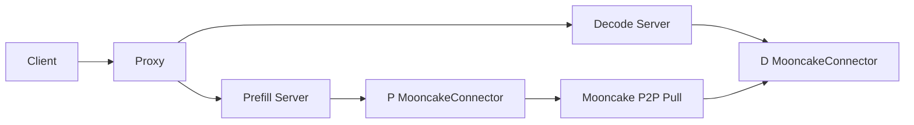
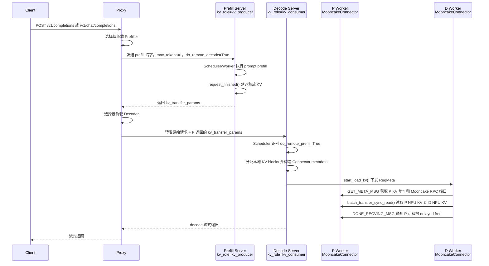

# NPU 硬件下基于 MooncakeConnector 的 PD 分离处理流程

## 1. 背景与范围

大模型在线推理中，prefill 偏向长 prompt 的集中计算和 KV Cache 写入，decode 偏向逐 token 生成的低延迟和持续吞吐。PD 分离将两类负载拆到不同 vLLM server，便于业务独立扩缩 P/D 节点，降低长 prompt 对 decode 延迟的影响，并通过远端 KV Cache 复用避免重复 prefill。

本文范围限定为 vLLM Ascend NPU 硬件下的在线 PD 分离流程：P 节点生成并短暂保留 KV Cache，D 节点通过 MooncakeConnector 从 P 侧 NPU 显存拉取 KV 后继续 decode，Proxy 负责请求编排和 P/D 负载选择。KV 传输仅讨论 `MooncakeConnectorV1` / `MooncakeConnector`，不展开 NIXL、GPU connector、layerwise proxy 或其他 connector。

## 2. 总体架构

### 2.1 简化总体架构图



### 2.2 端到端时序

在线 PD 分离链路中，Client 只感知 Proxy 暴露的 OpenAI 兼容接口；Proxy 负责请求编排和 P/D 负载选择；Prefill Server 以 `kv_role=kv_producer` 运行，Decode Server 以 `kv_role=kv_consumer` 运行；P/D 节点内部由 vLLM scheduler 调用 KV Connector 接口，由 worker 侧通过 ZMQ side channel 和 Mooncake TransferEngine 完成 NPU KV Cache 地址交换与传输。



关键关系：

- Proxy 不直接搬运 KV Cache，只负责 HTTP 请求编排、P/D 实例选择和 `kv_transfer_params` 透传。
- P/D 节点内部的 vLLM scheduler 通过 KV Connector 接口决定是否延迟释放、是否拉取外部 KV。
- P/D worker 通过 Mooncake TransferEngine 和 ZMQ side channel 完成真实 NPU KV Cache 地址交换、远端读取和完成通知。
- P 节点生成 KV 并保留到 D 拉取完成，D 节点把远端 KV 写入本地 NPU KV Cache 后继续 decode。

Mermaid Live 链接：[vllm_ascend_pd.mermaid](https://mermaid-live.nodejs.cn/view#pako:eNq1Wn1TE9ca_yrn5i-oMSFBEDIXZ7hA1VtBBKodX2ZnSRbYIdnd7m6o1nEmVkHeoS1QQSzlKuptFegtIhLA79LJbpK__Ar3OS_7ks0m0PZeRyWc1-c8L7_nd86Tu4G4nBACsYAmfJkWpLjQLvKDKp-6KSH4w6d1WUqn-gX1pkRbFF7Vxbio8JKO2hCvobakKEh6eWc37uxW5dt3_t6vhs_VJGU-wfXzSR724BTcXusz6VM6SxgQk0k6bySZTCFNUEeEWtIwPMKpclJogZ-wSiIdx7KVr9MbHxISrsUQaUgnBZUu2ynLUpwfFtpkSRLiuqza_b5iXXMvdU1WhyuuQzt9F-ntKxFIkBKiNNg3pAp8gi722dU2HsQo6fFZqa-DI9rtU3lJGxDUDmlQlAS6BFs9_8uW_8T2ShPbBewI_vPar_XgaXQI6hHiIz5S4-ZqUrdfc63x51TYbluVLfNXjNrurHOsp8VlSUunnChQYXWkDvbXROujweiZhmC0vp5t0SXrApJHBBW1BdtjyJjfMiZfFR_vmptvPx6sWMYHPRvjT42XU8b0knceeFsMdhgUNV1QObw7Vq9WQ6WKhFBh9p0xt4Q-u4pID0rwOs8puorCSBviFXqcKIzbXM9v_oD6k3J8mEsKEmmvD6H8wpo5Po_slSEsNYHjEwmqxjMhZP72yhibNsa3Pa5CRQUBT587h73QJWdKSMnqnRoQI4g08Wuh1vdYbGvLUK2DgB2dgs7jI5DN7wpkI05MBJEucKoS5xRZ1YOWRbwSBxHgE0eOqAUR_OCTnKjccwuKA88yBPILsXJJ8QSmvSFeSoBWhwUiBxGjX5QS6HrnFdRz-fO-jh7Sln8zYRyNovMdfVxnR18rmKL9clcH19PRdvVi13m6A-xZ7kDRs-BA4EQNJ3Mg5vjV_Kf9_-w-tnOYq69BDl8XaWce0n68h5ChgDBeE5XgSfkZYTzTuYozl6Zz8H9aCA0Kek2tn0ry-y_Mp2ugQoXGIKcrHBYDnWtBCaJVq4Uc1Jh_YYwv55_smLMb5uRGcWG5ihEbAAHO1Aej0TP-RqTmi8DmNF2iwtY789dvQIeFoyOaJem8NuyvMXShr68bdV-GhBEeiYTjckpJCroIIERE03RQSapFV9NCEKX425wuDwuS1tIVRJASU4reEgqFqkkL7hZtAsxqrCZtlMAVSIaKmQkra8EQ4_2uMfdtMXPfzmT0MK6lVHFwSEfyAOq2w0ix5nNaXFapijUhCTJxdhdzUYYRllnFREs6LTIP6CbxfJyCvjjdQyefvpiIobt4-j235gb4pFaqugj8Jkr2bxba6My1OUgcfEpDLegu6UrInAreDABFPSdGbOHpYueK0d1IJ98PGCIkOHa22A0w1C3Sc68chGLInHhZWJ-2dOdWTgTl9n5GRFwIm9l89nvwbR8cw_kvZqtyQJREDVqYos1nGfPtFEZ573mIb5Exub0FpOm8ntZaPr3YdbH3Qkc7d6mj63zfBa6ttbu7o50GS3a38GGt-GjSXDiigPHxYNr88WEx81Phw4Lx5Md8dhkR0ofyKw9RuWYtvD7t8v9_9l7uOrkhLG37WYIZyWUI1kGxTUxo1BIlfU4igi53x5Cs6d42kqO8bQxO7HacqWiAWgnL6im3PjZaUsBZzgkPPq6LIwJzUmrC3Ien-cVlxHossK-WbhooX2moilT1JbFPcw6J_MLhawh-i35VDXwW3VT3qoXJOIDb_2D8GvPTub0MOLwTyMbsGiQ_BnfoVEWP8tUBQepmrIdqOjjjZNvC9gNj_4Wx_KqwNWaM_1L4sIrzXkX4oymHxR7kIw4bXhK-4lK8jhuZBVkUFqY2UJkbOwFI4wfVQAKuYc5DpmOvrT2NV8baS-v2ssCbYG5tJXnSCuR7gcMxDQxqACdmPgneyKTJ7e1buWmsODoDKd5Y3aYhTfopw7LjBgKRujLOu1xaGuIxvjj9FqQvZwub2xhpMPRpoAwCgvGRSlL2p8VkAtNuyuOBO-i8hVoEVuAW8iUmjgwHPGL5B3nQG8Vhh1qWBb271UlFJc1KnAW4uzHh12hDgT8OuDGgIr9oAK-tj1Tz2AbHY-kVCkGsFt6-Y_4KhM-cmgDq9_FgvLC-YYyOIgjCYiZbOPr248GEH2cCL1F1jlzdh0dqUoyoUzt4aVQLwv0hz4mRrCIw44A4mFbB5p5JfnsywgAjaNjgWelkUrODpfNSa1iDINeEWPkoECPi4m8xW-GWUw4Bm8SjIPnXROjtAcCDtoY9RLDWMdeJZntOR6f7iVguUBiVbWO5AZ_UsaGMrfdAeH34a4uXv9Jp5ZrlcIxaLs1Lwxo3AKEFzl1TS_Vkbs1hWkFXA90iPAoxDvz4J2P7IYQwyGHsL1hntUZZ1jFXgSt2Q_YH5ZvT-DN2okEBGb8uGgcZysJ4DPcJrBasjBs3YI1TSFE-YfLfQjgZVzpFqZBEQmPu5-JqJpedpbyISoiJhkdI5v8VzFLMrBh7ewCAKOLs7dxO4LZpAQFDIgtJSm6IcCAXJ4BzxQFpAK7x_v5Hwjefw38BqzNmFgvvtqiMuWzWmFz3hdzfxxaQF9ro3S4WwY5CLcXQBBgPbsvtzVT0n3MndJ_ChyfG6Ia9El4WxDWOHnrgAJlPdoznL8EHCls75uNZlr6zh5bNAIiMua3Cg0PIMebiM2P1lfF8BdvUMhesTMyV25v8074MF11jbT-3P-u6SCDj_gq4owrXSkiWnCjpjWc4nLKYQaP4beRVcWXOXN3Pv5wx3sxj-jOoymnFvvyCT4P8VtCCpKQb8yRz6t8MaYlAjuQ4gM9faQ13XmhF5vIm9rPVfXN5yxlRfj7jxTfmj6voOFv5hC3RHIRD4cV9iAiPZn0CwVzcLj6aA7ctiwhHPuJGgLv4iYAgbznYgWhuNKx2tvzEe3NzkvoO-KM5OYlVWng5BrEHMZDPPjTHl_KvMvmlOfhcIVqNowz8LWYyxvQSiVlKXw7HmAKIPXLZGepp2GzUUIW3265zSYlKDuYb3FxS1HTmvObjLVAunIJufDQFJqM09USWID6C7YADan6aeBSCgMhPPHJESsqygoGfWVgeGNAEHYkSulEX9Ml9n9hGUVgGKjVDNTAz5_eNvRfWFmGf1cP-OjmBNsnbDgYBSi1zYPOpMQx4z1fMp-sOMXGBHpwYumgDwHthZ62w8wxWKD54BUqi2gojp8HKMy4SVYlNRZrOAv_HT24V2BR-2svtP8_tf4dfbKwnPeu1qsd-UiRPgB1Xfh_7zvUQWGON5zp7zwfRzcDNgHX1gUmnLQM4z4d4escVMtf3WZQxXA8zPdHbqE1f2HXTlU5Exf_iSR_WDr433jxmYJZyP8_67HLDluzWDSzOLXduZGmwbEwVrltXBzwX_tVVsA72lsVtc2Yzd_BT4eh7sJDfA6TnRM7t0DqB6z2UEs4BUYUkkeTvwCBRSgi3wb9AQHeL_TIKLFRThHg6yZN7NyW46G8tsK0kgFcu5A5nIPWYqxljfpaBghX4lqeSxUBSc2HLnL6POvuANa14NkSnWiwy4jkQBjQyMExsGyYBQa9GNP9papyiFZBaTbc-wi1yUB8iv_mQy4rR65NhMKKVMkE7sWxOm4s72E7OtVGEi5zKMXBxiFYdu3POUJSkYZ3ff2lOHRSejVagMBWlpJvY79XW3ZR8Dle4UHhwhuAxMZcLjy0hMUyzI9Cju6FbS4pxL_pQsKDP4P347u-4oXZHinP4ZbtGEzRNlCU7si3DBW27Bd1mY0GBF7WLMDRSzcdHELXA1gtbWXtQ92lbAvqSQGPHtYiFSKqAuWud59Zhax0_BJbnhHNuruwxB41PCADjw2hxPQsbAEVL8bo3BCH_V2EpIPHTDczlvQYpPpoxl7bBU_B7aMIui5ira-bqEzwB08y9B8avmVImZsxvAclDA2lNSCBZqUxUiE48InNfiWAHMpeTFXYAXVbjQyFZ0UJcG8drcbB_iBhaAebvTO2_Q32zBm43tR5uZa7-_JfkctBMUtKcAvCSYLviy7tDb6HRPQlzevzCTOMuu4O1ObthcV0gNBCXqOs6vs6NzWDyzElfu6b7pH4rWo8JVcwFxl-XBz4C-cLW6eg9_sMoDDB_2M1lR7EEXdeR-dOBcTAHGJOfH_vf5ntc8yiv2x2f891zaN53PRm574OchhEegqjWv-iYz65BOmJwy9bAT-YYU8fn8-ubhc3nEMFkV3d0gn7ASBRYQV24MkZDiu6NyF20-OCQrgCrnRD9qVQRfNEDTm5sfwtXBVx7nHuGWts-w6UHY-Y34MP06f8PADarsYKoO1tw4goAEEZ0M1sD1tnN7Hph9zdfzVKCEYJPWDxzYga4eh5A4c0z6-0zAUmaim0VW4zb7MZ9_QKo7xftd8ex9cmSJzWZ63gJ0g2bv_GGPLcP9mL7IkxO0aLq13uHcoZuZZeYjuxTyZ1Vd6eztQfCgNGo74VB7yr1-zJEjH0DIluBhjdp66BH4atF_3Yf02un4xMwcZoNK-0VCoq_qcivqOnglGzjZV0_fZjwfj2CkzEx8P8IsHzGdv5AiyRmFr0fF-TZcVnIc1WcIPac5I1xOQI3ysdLzv8BJVgtlYxY4aAwAWv-bT119XGnOVWPFXB5xvpQDuwo0Vw-XhJq2anCIYdMq37O4ukdKFcbVG8SlUlJTbGDNY2q5WnHNVb5ylE-WFIK-9y138WKtXvhsAkkcawQXqqpm_CUxO4SK3N-tGJt_6ml2gcj9jwRCsC09djUTh6qviiyUnOPzXd1d_PFVXViV1MxanxlKxhFt5IcX1lSJShsWCV1oMY-7URmF3FKIZOIe5sIuLMu70ReEVbhdXL13q5LoufnGJa_3H5Z4-6L_yeUdvH9d3sbMDUh8yDvaN8d0S4JcSgWBgUBUTAVqGDaQEyOP418BdPORmQB8SUsLNQAw-JoQBPp3U4YIs3YNpCi9dl-WUNVOV04NDAVayDVDgZl9NtIfAfoLahiE8EIs2NZA1ArG7gduBWKSpMXS2sTnaWN8MH5saok3BwB1ohtZIU31dY11zc_3ZurNNDfeCga_JttFQXaQOqEJjtKGpqaGurrnp3n8B7TpreA)

## 3. 初始化流程

### 3.1 P 节点启动配置

P 节点需要以 `kv_producer` 角色启动，并把 KV buffer 放在 NPU：

```shell
vllm serve "/xxxxx/DeepSeek-V2-Lite-Chat" \
  --host localhost \
  --port 8100 \
  --tensor-parallel-size 2 \
  --data-parallel-size 2 \
  --gpu-memory-utilization 0.8 \
  --kv-transfer-config \
  '{"kv_connector": "MooncakeConnectorV1",
    "kv_buffer_device": "npu",
    "kv_role": "kv_producer",
    "kv_parallel_size": 1,
    "kv_port": "20001",
    "engine_id": "0",
    "kv_rank": 0,
    "kv_connector_extra_config": {
      "prefill": {"dp_size": 2, "tp_size": 2},
      "decode": {"dp_size": 2, "tp_size": 2}
    }}'
```

字段含义：

| 字段                                  | P 节点含义                                   |
| ----------------------------------- | ---------------------------------------- |
| `kv_connector`                      | 使用 vLLM Ascend 注册的 `MooncakeConnectorV1` |
| `kv_buffer_device`                  | KV buffer 位于 `npu`                       |
| `kv_role`                           | `kv_producer`，表示本节点生产并保留 KV Cache        |
| `kv_port`                           | Mooncake/ZMQ side channel 的基础端口          |
| `engine_id`                         | 当前 vLLM engine 的唯一标识，P/D 之间不能冲突          |
| `kv_connector_extra_config.prefill` | P 侧 DP/TP/PP 配置                          |
| `kv_connector_extra_config.decode`  | D 侧 DP/TP/PP 配置，用于计算跨节点拉取映射              |

### 3.2 D 节点启动配置

D 节点以 `kv_consumer` 角色启动，使用不同的 `kv_port` 和 `engine_id`：

```shell
vllm serve "/xxxxx/DeepSeek-V2-Lite-Chat" \
  --host localhost \
  --port 8200 \
  --tensor-parallel-size 2 \
  --data-parallel-size 2 \
  --gpu-memory-utilization 0.8 \
  --kv-transfer-config \
  '{"kv_connector": "MooncakeConnectorV1",
    "kv_buffer_device": "npu",
    "kv_role": "kv_consumer",
    "kv_parallel_size": 1,
    "kv_port": "20002",
    "engine_id": "1",
    "kv_rank": 1,
    "kv_connector_extra_config": {
      "prefill": {"dp_size": 2, "tp_size": 2},
      "decode": {"dp_size": 2, "tp_size": 2}
    }}'
```

D 节点依赖 `kv_connector_extra_config` 知道 P/D 的并行拓扑，后续会据此计算需要从哪些 P rank、哪些端口、哪些 block 拉取 KV。

### 3.3 Proxy 启动

Proxy 使用 P/D server 的 OpenAI API 地址做负载均衡：

```shell
python load_balance_proxy_server_example.py \
  --host localhost \
  --port 8000 \
  --prefiller-hosts host1 host2 \
  --prefiller-ports 8100 8101 \
  --decoder-hosts host3 host4 \
  --decoder-ports 8200 8201
```

Proxy 初始化入口：

```python
@asynccontextmanager
async def lifespan(app: FastAPI):
    global proxy_state
    proxy_state = ProxyState(global_args.prefiller_instances,
                             global_args.decoder_instances)
    print(f"Initialized {len(proxy_state.prefillers)} prefill clients "
          f"and {len(proxy_state.decoders)} decode clients.")
    yield
```

初始化后，`ProxyState` 中会创建：

- `prefillers`：P server 的 `ServerState` 列表。
- `decoders`：D server 的 `ServerState` 列表。
- `prefiller_heap`：按 `active_tokens + active_kv_cache * 0.3` 排序的 P 节点优先队列。
- `decoder_heap`：按 `active_tokens` 排序的 D 节点优先队列。
- `NodeListener`：用于检查等待加入的实例，以及在请求清空后移除 tainted 实例。

### 3.4 MooncakeConnector 初始化

`MooncakeConnector` 按 vLLM 传入的 role 构造 scheduler 侧或 worker 侧对象：

```python
class MooncakeConnector(KVConnectorBase_V1):
    def __init__(self, vllm_config, role, kv_cache_config=None):
        assert vllm_config.kv_transfer_config is not None
        self.engine_id = vllm_config.kv_transfer_config.engine_id
        self._connector_metadata = MooncakeConnectorMetadata()

        if role == KVConnectorRole.SCHEDULER:
            self.connector_scheduler = MooncakeConnectorScheduler(
                vllm_config, str(self.engine_id))
            self.connector_worker = None
        elif role == KVConnectorRole.WORKER:
            self.connector_scheduler = None
            self.connector_worker = MooncakeConnectorWorker(
                vllm_config, str(self.engine_id))
```

worker 侧初始化会读取 P/D 并行配置，并创建 Mooncake TransferEngine：

```python
self._get_prefill_decode_size(vllm_config)
os.environ["ASCEND_TRANSFER_TIMEOUT"] = str(get_transfer_timeout_value())
if self._prefill_tp_size < self._decode_tp_size:
    raise ValueError("prefill_tp_size must be greater than or equal to decode_tp_size")

self.kv_role = vllm_config.kv_transfer_config.kv_role
self.side_channel_port = (
    vllm_config.kv_transfer_config.kv_port
    + vllm_config.parallel_config.data_parallel_rank
    * vllm_config.parallel_config.tensor_parallel_size
    * vllm_config.parallel_config.pipeline_parallel_size
    * self.pcp_size
)
self.engine = global_te.get_transfer_engine(self.side_channel_host,
                                            device_name=None)
self.te_rpc_port = self.engine.get_rpc_port()
```

## 4. 请求入口与 Proxy 调度流程

### 4.1 HTTP 入口

Proxy 对外暴露 OpenAI 兼容接口：

```python
@app.post("/v1/completions")
@with_cancellation
async def handle_completions(request: Request):
    return await _handle_completions("/completions", request)

@app.post("/v1/chat/completions")
@with_cancellation
async def handle_chat_completions(request: Request):
    return await _handle_completions("/chat/completions", request)
```

每个请求进入 `_handle_completions()` 后，Proxy 会先增加 `request_num`，读取请求体并估算请求长度：

```python
proxy_state.request_num += 1
req_data = await request.json()
req_body = await request.body()
request_length = len(req_body)
instance_info = await _handle_select_instance(api, req_data, request_length)
```

### 4.2 P 节点选择

P 节点按 prefill score 和当前 KV 占用选择：

```python
def calculate_prefill_scores(self, request_length: int) -> float:
    length_score = request_length / 4.0
    input_score = length_score * 0.0345 + 120.0745
    return input_score

def select_prefiller(self, token_count):
    priority, chosen, server = heapq.heappop(self.prefiller_heap)
    self.prefillers[chosen].active_tokens += token_count
    self.prefillers[chosen].active_kv_cache += token_count
    self._update_prefiller_priority(chosen)
    return chosen
```

P priority 的计算方式：

```python
priority = server.active_tokens + server.active_kv_cache * 0.3
```

含义：

- `active_tokens` 近似表示当前计算压力。
- `active_kv_cache` 只在 prefiller 上维护，用于避免持续把请求分给 KV 占用较高的 P 节点。
- P 请求完成后先释放 `active_tokens`，P 上的 KV 占用要等 D 开始输出或异常释放后再扣减。

### 4.3 向 P 发送 prefill 请求

Proxy 向 P 发送一个受控请求，用于触发 P 执行 prefill 并返回远端 KV 元信息：

```python
req_data["kv_transfer_params"] = {
    "do_remote_decode": True,
    "do_remote_prefill": False,
    "remote_engine_id": None,
    "remote_block_ids": None,
    "remote_host": None,
    "remote_port": None,
    "aborted_request": list(aborted_requests),
}
req_data["stream"] = False
req_data["max_tokens"] = 1
req_data["min_tokens"] = 1
```

关键点：

- `do_remote_decode=True` 告诉 P：本次请求后续会由远端 D decode，需要保留 KV 并返回可拉取的 metadata。
- `max_tokens=1` 和 `min_tokens=1` 让 P 以最小 decode 步结束，目的是完成 prefill 和触发 `request_finished()`。
- `aborted_request` 会把此前 Proxy 侧记录的中止请求传给 P，用于释放异常路径遗留 KV。

P 返回后，Proxy 读取响应中的 `kv_transfer_params`：

```python
response_json = response.json()
kv_transfer_params = response_json.get("kv_transfer_params", {})
if kv_transfer_params:
    req_data["kv_transfer_params"] = kv_transfer_params
```

### 4.4 D 节点选择与转发

D 节点按 decode score 选择：

```python
def calculate_decode_scores(self, request_length: int) -> float:
    return request_length

def select_decoder(self, token_count):
    priority, chosen, server = heapq.heappop(self.decoder_heap)
    self.decoders[chosen].active_tokens += token_count
    self._update_decoder_priority(chosen)
    return chosen
```

随后 Proxy 将包含 P 返回 `kv_transfer_params` 的原始请求转发给 D：

```python
async for chunk in stream_service_response_with_retry(
    instance_info.decoder.client,
    api,
    req_data,
    request_id=instance_info.request_id,
    max_retries=global_args.max_retries,
    base_delay=global_args.retry_delay,
):
    if not released_kv and chunk:
        proxy_state.release_prefiller_kv(instance_info.prefiller_idx,
                                         instance_info.prefiller_score)
        released_kv = True
    yield chunk
```

当 D 开始返回第一个 chunk 时，Proxy 认为 D 已经可继续 decode，于是释放 P 节点统计中的 `active_kv_cache`。

### 4.5 recomputed 与异常释放

如果 D 返回的 `stop_reason` 是 `recomputed`，Proxy 会把已生成内容拼回 prompt，并重新走 P/D 选择流程：

```python
if stop_reason == "recomputed":
    retry = True
    retry_count += 1
    req_data["prompt"] = origin_prompt + generated_token
    req_data["max_tokens"] = origin_max_tokens - completion_tokens + retry_count
    tmp_request_length = len(json.dumps(req_data).encode("utf-8"))
    instance_info = await _handle_select_instance(api, req_data, tmp_request_length)
    break
```

如果流式 decode 失败，Proxy 会标记 P 侧请求为 aborted，并释放 P 侧 KV 统计：

```python
proxy_state.abort_prefiller_request(instance_info.prefiller_idx,
                                    instance_info.request_id)
proxy_state.release_prefiller_kv(instance_info.prefiller_idx,
                                 instance_info.prefiller_score)
```

## 5. vLLM 调度侧流程

MooncakeConnector 的 scheduler 侧围绕同一个请求先后在 P 节点和 D 节点执行。按在线请求时序看，先是 P 侧识别远端 decode 诉求并返回可传输的 KV 元信息，然后 D 侧识别远端 prefill 诉求、分配本地 blocks，并把拉取任务下发给 worker。

### 5.1 P 侧识别远端 decode 请求

Proxy 发给 P 的请求携带 `do_remote_decode=True`，表示本次 prefill 结果后续要给远端 D 节点使用。P 侧请求结束后，`request_finished()` 先判断是否满足远端 decode 条件：

```python
if (
    params is None
    or not params.get("do_remote_decode")
    or request.status != RequestStatus.FINISHED_LENGTH_CAPPED
):
    return False, None
```

这里要求请求以 `FINISHED_LENGTH_CAPPED` 结束，和 Proxy 侧 `max_tokens=1` 的受控 prefill 请求配合，用于触发 P 侧生成远端 KV metadata。

### 5.2 P 侧延迟释放 KV 并返回 metadata

P 侧已经计算出的 KV blocks 不能立即释放，因为 D 侧还需要通过 Mooncake 拉取这些 blocks：

```python
computed_block_ids = block_ids
delay_free_blocks = len(computed_block_ids) > 0
if delay_free_blocks:
    self._reqs_need_send[request.request_id] = time.time()
```

随后 P scheduler 返回给 Proxy 的 `kv_transfer_params` 包含 D 拉取 KV 所需的全部信息：

```python
return delay_free_blocks, dict(
    do_remote_prefill=True,
    do_remote_decode=False,
    remote_block_ids=computed_block_ids,
    remote_engine_id=self.engine_id,
    remote_request_id=request.request_id,
    remote_host=self.side_channel_host,
    remote_port=self.side_channel_port,
    remote_pcp_size=self.pcp_size,
    remote_dcp_size=self.dcp_size,
    remote_ptp_size=self.tp_size,
    last_token_id=request.output_token_ids[-1],
    remote_multi_nodes_meta_mapping=self.multi_nodes_meta_mapping,
    num_prompt_blocks=num_prompt_blocks,
)
```

这份字典经由 vLLM OpenAI 响应返回给 Proxy，再由 Proxy 填入给 D 的请求体。

### 5.3 D 侧声明远端 KV 命中

D 收到 Proxy 转发的请求后，`kv_transfer_params` 中的 `do_remote_prefill=True` 表示 prompt KV 已经在 P 侧生成，D 应该远端加载而不是重复 prefill：

```python
def get_num_new_matched_tokens(self, request, num_computed_tokens):
    params = request.kv_transfer_params
    if params is not None and params.get("do_remote_prefill"):
        assert num_computed_tokens % self.block_size == 0
        count = max(len(request.prompt_token_ids) - num_computed_tokens, 0)
        return count, count > 0
    return 0, False
```

返回值含义：

- `count`：可以从外部 KV Cache 加载的 token 数。
- `count > 0`：表示加载是异步发生的，worker 会在 scheduler step 之间拉取 KV。

### 5.4 D 侧记录待接收请求

D scheduler 分配本地 KV blocks 后，将本地 block 和 P 返回的远端信息组合到 `_reqs_need_recv`：

```python
if params is not None and params.get("do_remote_prefill"):
    if params.get("remote_block_ids"):
        if all(p in params for p in (
            "remote_engine_id", "remote_host", "remote_port", "remote_request_id")):
            local_block_ids = blocks.get_unhashed_block_ids() if num_external_tokens > 0 else []
            self._reqs_need_recv[request.request_id] = (
                request, local_block_ids, num_external_tokens)
    params["do_remote_prefill"] = False
```

这一步将 P 的 `remote_block_ids` 映射到 D 的 `local_block_ids`，后续 worker 会按这些 block id 执行 NPU KV 拷贝。

### 5.5 构造 worker metadata

每轮 scheduler 输出前，scheduler 侧构造 `MooncakeConnectorMetadata`，把 D 侧待接收请求和 P 侧 delayed free 请求统一交给 worker：

```python
meta = MooncakeConnectorMetadata()
for req_id, (req, block_ids, num_external_tokens) in self._reqs_need_recv.items():
    meta.add_new_req(
        request_id=req_id,
        local_block_ids=block_ids,
        num_external_tokens=num_external_tokens,
        kv_transfer_params=req.kv_transfer_params,
    )
self._reqs_need_recv.clear()
meta.requests_to_send = self._reqs_need_send
meta.reqs_in_batch = self._reqs_in_batch
```

metadata 中包含三类信息：

- `requests`：D worker 需要拉取 KV 的请求。
- `requests_to_send`：P worker 上需要 delayed free 的请求。
- `reqs_in_batch`：本轮 batch 中涉及远端 prefill 或远端 decode 的请求，用于任务追踪。

## 6. Worker 与 Mooncake KV 传输流程

### 6.1 注册 NPU KV Cache 地址

vLLM worker 初始化 KV Cache 后会调用 `register_kv_caches()`。MooncakeConnectorWorker 在这里计算每个 block 的字节长度，并注册 NPU buffer：

```python
for cache_or_caches in kv_caches.values():
    for i, cache in enumerate(cache_or_caches, 0):
        base_addr = cache.data_ptr()
        region_len = self.num_blocks * self.block_len[i % length]
        kv_caches_base_addr.append(base_addr)
        ptrs.append(base_addr)
        lengths.append(region_len)
global_te.register_buffer(ptrs, lengths)
```

注册完成后构造本 worker 的元信息：

```python
metadata = MooncakeAgentMetadata(
    engine_id=self.engine_id,
    te_rpc_port=self.te_rpc_port,
    kv_caches_base_addr=kv_caches_base_addr,
    num_blocks=self.num_blocks,
    local_ip=get_ip(),
)
self.xfer_handshake_metadata = metadata
```

然后按 `kv_role` 启动不同后台线程：

```python
if self.kv_role == "kv_producer":
    self.kv_send_thread = KVCacheSendingThread(...)
    self.kv_send_thread.start()
else:
    self.kv_recv_thread = KVCacheRecvingThread(...)
    self.kv_recv_thread.start()
```

### 6.2 P 侧发送线程

P worker 的 `KVCacheSendingThread` 主要监听 ZMQ ROUTER：

```python
device_index = (
    self.pp_rank * self.tp_size + self.tp_rank
    + self.pcp_rank * self.prefill_tp_size
)
handshake_port = self.side_channel_port + device_index
path = make_zmq_path("tcp", self.side_channel_host, handshake_port)
with zmq_ctx(zmq.ROUTER, path) as sock:
    self.ready_event.set()
    self.run_busy_loop(sock)
```

它响应两类消息：

```python
if msg[0] == GET_META_MSG:
    sock.send_multipart((identity, b"", encoded_data))
elif msg[0] == DONE_RECVING_MSG:
    request_id = msg[1]
    self.task_tracker.update_done_task_count(request_id)
    sock.send_multipart((identity, b"", b"ACK"), flags=zmq.NOBLOCK)
```

含义：

- `GET_META_MSG`：D worker 请求 P worker 的 `MooncakeAgentMetadata`，包括 P KV Cache 地址列表和 TransferEngine RPC 端口。
- `DONE_RECVING_MSG`：D worker 已完成 KV 拉取，P worker 可以把 delayed free 的请求标记为完成。

### 6.3 D 侧接收线程

D worker 的 `start_load_kv()` 遍历 scheduler 下发的 `metadata.requests`，把每个远端拉取任务加入接收线程队列：

```python
for req_id, meta in metadata.requests.items():
    prefill_tp_size = (
        meta.remote_ptp_size
        if getattr(meta, "remote_ptp_size", None)
        else self._prefill_tp_size
    )
    tp_num_need_pulls = self._get_tp_num_need_pulls(prefill_tp_size)
    remote_req_id = meta.remote_request_id
```

简单场景下，D 按请求 id 选择需要连接的 P rank：

```python
chosen_rank_list = self._get_remote_rank(remote_req_id, prefill_tp_size)
remote_handshake_port_list = [[x + meta.remote_port] for x in chosen_rank_list]
```

然后把任务交给 `KVCacheRecvingThread`：

```python
self.kv_recv_thread.add_request(
    request_id=req_id,
    remote_request_id=remote_req_id,
    local_block_ids=meta.local_block_ids,
    remote_block_ids=meta.remote_block_ids,
    remote_engine_id=remote_engine_id,
    remote_host=remote_host,
    remote_handshake_port=remote_handshake_port_list[i][0],
    offset=i,
    tp_num_need_pulls=tp_num_need_pulls,
    all_task_done=(i == tp_num_need_pulls * self._prefill_pp_size - 1),
)
```

PCP/DCP 场景下，会先调用 `_get_kv_split_metadata()`，根据 P/D 的 context parallel 和 KV head 分布计算：

- `remote_handshake_port_list`：当前 D rank 需要访问的 P rank 端口。
- `local_block_ids_list`：D 本地要写入的 block。
- `remote_block_ids_list`：P 侧要读取的 block。
- `remote_port_send_num`：每个 P port 需要收到多少个 DONE 信号。

### 6.4 真实 KV 传输

D 接收线程从队列取任务后执行 `_transfer_kv_cache()`：

```python
request_data = self.request_queue.get()
self._handle_request(request_data)
```

传输前先根据远端 engine 和 handshake port 获取或缓存 P 侧 metadata：

```python
if (
    remote_engine_id not in self.kv_caches_base_addr
    or remote_handshake_port not in self.kv_caches_base_addr[remote_engine_id]
):
    self._get_remote_metadata(remote_host, remote_handshake_port)
```

`_get_remote_metadata()` 通过 ZMQ 从 P 获取 KV 地址和 Mooncake RPC 端口：

```python
ensure_zmq_send(sock, self.encoder.encode((GET_META_MSG, "")),
                f"{remote_host}:{remote_handshake_port}")
metadata_bytes = ensure_zmq_recv(sock, self.remote_poller,
                                 f"{remote_host}:{remote_handshake_port}")
agent_meta = self.decoder.decode(metadata_bytes)
self.kv_caches_base_addr[engine_id][remote_handshake_port] = (
    agent_meta.kv_caches_base_addr)
self.remote_te_port[engine_id][remote_handshake_port] = agent_meta.te_rpc_port
```

随后构造 Mooncake TransferEngine 的源地址、目标地址和长度：

```python
src_list, dst_list, length_list = [], [], []
for k, (src_layer_base_addr, dst_layer_base_addr) in enumerate(
    zip(local_kv_caches_base_addrs, remote_kv_caches_base_addrs)
):
    block_len = self.block_len[k % block_length]
    inner_block_len = block_len // tp_num_need_pulls
    for remote_block_id, local_block_id in zip(grouped_remote_block_ids,
                                               grouped_local_block_ids):
        src = src_layer_base_addr + local_block_id[0] * block_len \
            + inner_offset * inner_block_len
        dst = dst_layer_base_addr + remote_block_id[0] * inner_block_len
        length = inner_block_len * len(local_block_id)
        src_list.append(src)
        dst_list.append(dst)
        length_list.append(length)
```

变量命名容易误解：这段代码运行在 D worker 中，`src_layer_base_addr` 实际来自当前 D 本地地址列表，`dst_layer_base_addr` 来自远端 P 地址列表；随后调用的是 Mooncake 的 `batch_transfer_sync_read()`，语义是从远端 session 读数据到本地地址：

```python
session_id = f"{remote_host}:{remote_transfer_port}"
ret = self.engine.batch_transfer_sync_read(session_id,
                                           src_list,
                                           dst_list,
                                           length_list)
if ret < 0:
    raise RuntimeError(f"Mooncake transfer failed, ret: {ret}")
```

### 6.5 NPU KV Cache 重排

KV 拉取结束后，D 侧可能需要把拉回来的 KV 重新排布成当前 D rank 需要的布局：

```python
is_kv_transfer_end = global_offset == tp_num_need_pulls * self._prefill_pp_size - 1
need_cat_cache = tp_num_need_pulls > 1 and is_kv_transfer_end
need_nz_cache = get_ascend_config().enable_kv_nz and is_kv_transfer_end
use_fused_op = ascend_envs.VLLM_ASCEND_FUSION_OP_TRANSPOSE_KV_CACHE_BY_BLOCK
```

场景说明：

- `need_cat_cache`：P/D TP 不同或 GQA/MHA KV head 分布不同，需要把来自多个 P rank 的 KV 按 head 拼接。
- `need_nz_cache`：NPU KV Cache 使用 NZ 格式，需要执行格式转换。
- `use_fused_op`：可用自定义 fused op 时优先用 `_C_ascend.transpose_kv_cache_by_block`。

fused op 路径：

```python
torch.ops._C_ascend.transpose_kv_cache_by_block(
    k_caches, v_caches, block_ids_tensor, block_size,
    num_kv_head, head_dim, tp_num_need_pulls, layers
)
```

通用重排路径：

```python
torch_npu.atb.npu_paged_cache_load(
    k_cache_layer,
    v_cache_layer,
    block_table,
    block_len_tensor,
    seq_starts=seq_start_tensor,
    key=k_buffer,
    value=v_buffer,
)
```

GQA/MHA head 拼接后写回：

```python
torch_npu._npu_reshape_and_cache(
    key=k_buffer,
    value=v_buffer,
    key_cache=k_cache_layer,
    value_cache=v_cache_layer,
    slot_indices=slot_mapping,
)
```

NZ 格式写回：

```python
torch_npu.npu_scatter_pa_kv_cache(
    k_buffer,
    v_buffer,
    k_cache_layer,
    v_cache_layer,
    slot_mapping,
)
```

## 7. 关键数据结构

### 7.1 Proxy 侧数据结构

| 数据结构           | 所在文件                                   | 作用                                                          |
| -------------- | -------------------------------------- | ----------------------------------------------------------- |
| `ServerState`  | `load_balance_proxy_server_example.py` | 描述一个 P/D server，包括 host、port、HTTP client、负载统计和 aborted 请求集合 |
| `ProxyState`   | `load_balance_proxy_server_example.py` | 维护 P/D 列表、优先队列、请求计数、实例增删和负载释放                               |
| `InstanceInfo` | `load_balance_proxy_server_example.py` | 保存一次请求选中的 P/D 实例、score、request id                           |
| `InstanceType` | `load_balance_proxy_server_example.py` | 标识 `prefill` / `decode` 类型                                  |

`ServerState` 的关键字段：

```python
self.url = f"http://{host}:{port}/v1"
self.client = httpx.AsyncClient(timeout=None, base_url=self.url, ...)
self.active_tokens = 0
self.active_kv_cache = 0
self.active_requests = 0
self.aborted_requests = set()
```

### 7.2 MooncakeConnector 侧数据结构

| 数据结构                        | 作用                                                                                       |
| --------------------------- | ---------------------------------------------------------------------------------------- |
| `MooncakeAgentMetadata`     | 单个 worker 暴露给远端的元信息，包括 `engine_id`、TransferEngine RPC 端口、KV Cache base address 和 block 数 |
| `ReqMeta`                   | D worker 拉取 KV 的请求级元信息，包括本地/远端 block、远端 host/port/engine、P/D 并行信息                        |
| `MooncakeConnectorMetadata` | scheduler 传给 worker 的批级 metadata，包含 `requests`、`requests_to_send`、`reqs_in_batch`        |
| `KVCacheTaskTracker`        | 追踪 send/recv 完成状态和 delayed free，支持超时强制释放                                                 |
| `RemotePortInfo`            | PCP/DCP 多端口场景下记录远端 port 的 host 和应接收 DONE 次数                                              |
| `SizedDict`                 | 限制远端 metadata 缓存大小，避免长期运行中无限增长                                                           |

`MooncakeAgentMetadata`：

```python
class MooncakeAgentMetadata(msgspec.Struct, omit_defaults=True, dict=True):
    engine_id: str
    te_rpc_port: int
    kv_caches_base_addr: list[int]
    num_blocks: int
    local_ip: str = ""
```

`ReqMeta`：

```python
@dataclass
class ReqMeta:
    local_block_ids: list[int]
    num_external_tokens: int
    remote_block_ids: list[int]
    remote_host: str
    remote_port: int
    remote_engine_id: str
    remote_request_id: str
    remote_pcp_size: int
    remote_dcp_size: int
    remote_ptp_size: int | None
    remote_multi_nodes_meta_mapping: dict[str, dict[str, Any]]
    num_prompt_blocks: int
```

### 7.3 `kv_transfer_params` 字段

| 字段                                | 产生方         | 消费方                 | 说明                                 |
| --------------------------------- | ----------- | ------------------- | ---------------------------------- |
| `do_remote_decode`                | Proxy       | P scheduler         | 表示 P 完成 prefill 后要为远端 D 保留 KV      |
| `do_remote_prefill`               | P scheduler | D scheduler         | 表示 D 不本地 prefill，改为拉取远端 KV         |
| `remote_block_ids`                | P scheduler | D worker            | P 侧已计算 KV block id                 |
| `remote_engine_id`                | P scheduler | D worker            | P engine 标识，用于 metadata 缓存和冲突检查    |
| `remote_request_id`               | P scheduler | D worker / P worker | P 侧请求 id，用于 rank 选择和完成通知           |
| `remote_host`                     | P scheduler | D worker            | P 侧 side channel host              |
| `remote_port`                     | P scheduler | D worker            | P 侧 side channel base port         |
| `remote_pcp_size`                 | P scheduler | D worker            | P 侧 prefill context parallel size  |
| `remote_dcp_size`                 | P scheduler | D worker            | P 侧 decode context parallel size   |
| `remote_ptp_size`                 | P scheduler | D worker            | P 侧 tensor parallel size           |
| `remote_multi_nodes_meta_mapping` | P scheduler | D worker            | 多节点场景中 rank 到 host/engine 的映射      |
| `num_prompt_blocks`               | P scheduler | D worker            | prompt 总 block 数，用于 CP 场景 block 拆分 |
| `last_token_id`                   | P scheduler | D server            | P 最后一个 token，供上层协议使用               |
| `aborted_request`                 | Proxy       | P server            | 通知 P 释放此前异常中止请求的 KV                |

## 8. 关键 API 接口

### 8.1 外部 HTTP API

| API                    | 方法   | 作用                                  |
| ---------------------- | ---- | ----------------------------------- |
| `/v1/completions`      | POST | OpenAI completion 入口                |
| `/v1/chat/completions` | POST | OpenAI chat completion 入口           |
| `/healthcheck`         | GET  | 返回 proxy 状态和 P/D 实例数量               |
| `/instances/add`       | POST | 动态增加 P 或 D 实例                       |
| `/instances/remove`    | POST | 动态移除 P 或 D 实例；有请求时先 taint，等待请求清空后移除 |

动态增删实例的数据格式：

```json
{
  "type": "prefill",
  "instances": ["127.0.0.1:8102", "127.0.0.1:8103"]
}
```

### 8.2 KV Connector scheduler 接口

| 接口                              | 作用                                                 |
| ------------------------------- | -------------------------------------------------- |
| `get_num_new_matched_tokens()`  | 判断当前请求可从外部 KV Cache 加载多少 token                     |
| `update_state_after_alloc()`    | 本地 KV blocks 分配后，记录需要 worker 拉取的远端 KV              |
| `build_connector_meta()`        | 将 scheduler 侧状态打包成 worker 可消费的 metadata            |
| `request_finished()`            | 请求结束时判断是否延迟释放 P 侧 KV，并生成给 D 的 `kv_transfer_params` |
| `set_xfer_handshake_metadata()` | 设置跨 rank handshake metadata，支持多节点 host/engine 映射   |

### 8.3 KV Connector worker 接口

| 接口                         | 作用                                            |
| -------------------------- | --------------------------------------------- |
| `register_kv_caches()`     | 注册 NPU KV Cache 地址到 Mooncake，并启动 send/recv 线程 |
| `start_load_kv()`          | worker 根据 scheduler metadata 启动远端 KV 拉取       |
| `get_finished()`           | 返回已完成 send/recv 的请求集合                         |
| `get_handshake_metadata()` | worker 暴露本地 KV handshake metadata             |
| `wait_for_layer_load()`    | MooncakeConnector 不做逐层 load，当前为空实现            |
| `save_kv_layer()`          | MooncakeConnector 不显式逐层 save，当前为空实现           |
| `wait_for_save()`          | MooncakeConnector 不显式 save，当前为空实现             |

### 8.4 Mooncake/ZMQ 接口

| 接口或消息                                       | 方向                   | 作用                                             |
| ------------------------------------------- | -------------------- | ---------------------------------------------- |
| `TransferEngine.batch_transfer_sync_read()` | D worker -> Mooncake | 从 P NPU KV Cache 远端 session 读取到 D NPU KV Cache |
| `GET_META_MSG`                              | D worker -> P worker | 请求 P 侧 `MooncakeAgentMetadata`                 |
| `DONE_RECVING_MSG`                          | D worker -> P worker | 通知 P 侧 KV 已拉取完成，可释放 delayed free               |
| `ACK`                                       | P worker -> D worker | P 收到 DONE 后确认                                  |

## 9. 特殊设计

### 9.1 Pull 模式 KV 传输

本文限定的 `MooncakeConnector` 使用 pull 模式：P 节点完成 prefill 后只返回远端 KV metadata，并延迟释放本地 KV Cache；D 节点拿到 metadata 后主动从 P 节点拉取 KV Cache。这个设计让 Proxy 不参与 KV 数据面，只负责请求编排和 `kv_transfer_params` 透传。

关键行为：

- P 侧 `request_finished()` 返回 `do_remote_prefill=True`、`remote_block_ids`、`remote_host`、`remote_port`、`remote_engine_id` 等字段。
- D 侧 scheduler 识别 `do_remote_prefill=True` 后预分配本地 KV blocks，并通过 worker 拉取远端 KV。
- D worker 先用 ZMQ `GET_META_MSG` 获取 P 侧 KV Cache 地址和 Mooncake RPC 端口，再调用 `TransferEngine.batch_transfer_sync_read()` 完成 NPU 间 KV 读取。
- D 拉取完成后发送 `DONE_RECVING_MSG`，P 侧收到 ACK 后释放 delayed free 请求。

### 9.2 P/D 独立并行策略

PD 分离允许 P 节点和 D 节点使用不同实例数和并行策略，从而分别优化 TTFT 与 TPOT：

- P 节点更关注长 prompt prefill 吞吐，可按输入长度和 prefill 峰值压力独立扩容。
- D 节点更关注逐 token 生成延迟和稳定吞吐，可按 decode 并发独立扩容。
- `kv_connector_extra_config.prefill` 和 `kv_connector_extra_config.decode` 需要同时描述两侧 DP/TP/PP 配置，D 侧会据此计算远端 rank、port 和 block 映射。

### 9.3 TP 对等与不对等

D worker 会根据请求 id 稳定选择 P rank，使同一个请求在各 D rank 上得到一致的远端 rank 选择：

```python
seed = string_to_int64_hash(req_id)
rand = random.Random(seed)
```

`tp_num_need_pulls` 描述一个 D rank 需要从多少个 P TP rank 拉取 KV 分片：

```python
if self.vllm_config.model_config.is_deepseek_mla:
    self.tp_num_need_pulls = 1
else:
    num_d_block_heads = max(1, self.num_key_value_heads // self.tp_size)
    num_p_block_heads = max(1, self.num_key_value_heads // self._prefill_tp_size)
    self.tp_num_need_pulls = num_d_block_heads // num_p_block_heads
```

TP 对等场景：

- 条件：P 侧 `prefill_tp_size` 等于 D 侧 `decode_tp_size`。
- 映射：每个 D TP rank 只连接对应的 P TP rank，`tp_num_need_pulls=1`。
- 传输：D rank 只从一个 P rank 拉取属于自己的 KV head/block 分片，不需要跨 P rank 拼接 KV head。

TP 不对等场景：

- 约束：仅支持 P 侧 TP 大于 D 侧 TP，且 P TP 是 D TP 的整数倍；如果 P TP 小于 D TP，worker 初始化会报错。
- 映射：`_get_remote_ranks_for_req()` 按请求 id 和 KV head group 选择远端 P rank 组，`tp_num_need_pulls` 决定每个 D rank 发起多少次 pull。
- 传输：`start_load_kv()` 会对同一请求向多个 `remote_handshake_port` 下发 `add_request()`，并用 `offset` 标识当前 pull 的位置。
- 重排：最后一个 pull 完成后，如果 `tp_num_need_pulls > 1`，D 侧触发 `need_cat_cache`，把多个 P rank 拉回来的 KV 按 head 拼接到 D 本地 KV Cache 布局。

### 9.4 MLA、GQA 与硬件约束

MooncakeConnector 的设计覆盖 MLA/GQA 等模型 KV Cache 形态，但不同形态会影响 block 长度推导、rank 映射和重排路径：

- MLA 场景通过 `model_config.is_deepseek_mla` 走特殊处理，通常 `tp_num_need_pulls=1`。
- GQA/MHA 的非对等 TP 场景需要按 KV head 分片拉取，并在 D 侧完成 head 拼接或格式重排。
- NZ 格式开启时，D 侧需要在 KV 拉取后执行 NPU 格式写回。
- 参考特性说明中 A2、A3 均为可用配置，但不支持异构 P/D 节点，例如 P 使用 A2、D 使用 A3。

## 10. 异常与资源释放

### 10.1 delayed free

P 侧在 `request_finished()` 中返回 `delay_free_blocks=True` 后，vLLM 不会立即释放该请求的 KV blocks。P worker 会把请求加入 delayed free 追踪：

```python
if self.kv_send_thread is not None and self.pcp_size * self.dcp_size == 1:
    for req_id, delay_start_time in metadata.requests_to_send.items():
        if self.tp_rank in self._prefill_get_remote_rank(req_id):
            self.kv_send_thread.add_delayed_request(req_id, delay_start_time)
        else:
            self.kv_send_thread.add_not_transfer_request(req_id)
```

D 拉取完成后发送 `DONE_RECVING_MSG`，P 侧 `KVCacheTaskTracker` 将请求放入 `finished_requests`，随后 vLLM 可以释放 blocks。

### 10.2 超时强制释放

如果 D 侧异常，P 侧 delayed free 不能永久保留。`KVCacheTaskTracker` 会按 `VLLM_NIXL_ABORT_REQUEST_TIMEOUT` 超时强制释放：

```python
if current_time - delay_start_time > envs.VLLM_NIXL_ABORT_REQUEST_TIMEOUT:
    self.delayed_free_requests.popitem(last=False)
    self.reqs_to_process.discard(request_id)
    expired_requests.add(request_id)
```

变量名来自 vLLM envs，但在 MooncakeConnector 中也用于 delayed free 超时控制。

### 10.3 Proxy abort 释放

Proxy 在 decode 流式异常时不会直接调用 P 的内部接口，而是在下一次向同一个 P 发送请求时携带 `aborted_request`：

```python
aborted_requests = proxy_state.acquire_aborted_prefiller_requests(prefiller_id)
req_data["kv_transfer_params"] = {
    ...
    "aborted_request": list(aborted_requests),
}
```

这使 P 能在正常请求路径中处理异常释放，避免 Proxy 直接依赖 vLLM 内部对象。

## 11. 新模型接入是否需要额外适配

### 11.1 通常不需要额外适配的情况

如果新模型已经能在 vLLM Ascend NPU 后端正常运行，并且 KV Cache 结构符合当前 MooncakeConnector 支持的几类布局，PD 分离通常不需要额外改代理或 Connector：

- 标准 KV Cache：形如 `[num_blocks, block_size, num_kv_heads, head_dim]` 或兼容布局。
- DeepSeek MLA：`model_config.is_deepseek_mla=True`，当前实现会把 `tp_num_need_pulls` 设为 1，并使用 MLA block length 推导。
- Sparse KV Cache：`register_kv_caches()` 通过 `len(first_kv_cache_tuple) == 3` 识别 sparse。
- P/D 使用一致的模型、tokenizer、max model len、block size 和兼容采样配置。
- P/D 的 `kv_connector_extra_config` 正确描述两侧 DP/TP/PP 配置。

这类模型的接入重点是部署参数正确，而不是改代码。

### 11.2 必须重点检查的模型属性

新模型接入 PD 分离前应检查：

| 检查项                                 | 原因                                               |
| ----------------------------------- | ------------------------------------------------ |
| `num_key_value_heads`               | 决定 TP 下每个 rank 的 KV head 分布和 `tp_num_need_pulls` |
| `head_dim`                          | 决定标准 KV block 字节数                                |
| `kv_lora_rank` / `qk_rope_head_dim` | MLA 场景下决定 K/V buffer 维度                          |
| KV Cache tuple 长度                   | 当前用 tuple 长度判断 MLA/Sparse/标准 KV                  |
| KV Cache shape                      | `register_kv_caches()` 通过 shape 推导 `block_len`   |
| `block_size`                        | P/D 必须一致，否则 block id 对应 token 范围不一致              |
| PP layer partition                  | P 开启自定义 PP 切分时，D 必须能用相同 partition 推导远端层范围        |
| NPU NZ 配置                           | `enable_kv_nz` 会改变 D 侧拉取后的写回格式                   |
| 自定义 attention cache                 | 非标准 KV Cache 地址布局可能需要修改地址计算和重排逻辑                 |

### 11.3 需要额外适配的情况

以下情况通常需要额外适配：

- 新模型的 KV Cache 不是当前 `register_kv_caches()` 可识别的标准、MLA 或 Sparse tuple。
- K/V cache 分层数量、tuple 顺序或 tensor shape 与现有 `block_len` 推导不兼容。
- 模型使用特殊 attention 结构，KV head 与 TP rank 的映射不能用当前 `_get_remote_ranks_for_req()` 逻辑表示。
- P 侧 PP layer partition 不是默认 vLLM split，且未通过 `pp_layer_partition` 显式传给 D。
- NPU KV Cache 需要新的 NZ、ND 或 fused op 格式转换。
- 多模态模型引入额外 cache，但该 cache 不属于现有 KV Cache 传输列表。

适配优先级建议：

1. 优先确认 vLLM Ascend 本地单节点 NPU 推理可用。
2. 再确认 P/D 使用相同模型权重、tokenizer、block size 和兼容的并行配置。
3. 若仅是 PP layer partition 不一致，优先通过 `kv_connector_extra_config.prefill.pp_layer_partition` 配置解决。
4. 若是 KV Cache shape 或格式不同，再适配 `register_kv_caches()`、`_transfer_kv_cache()` 和重排函数。
5. 若需要模型特定逻辑，遵循 vLLM Ascend 插件规范，优先使用 patch、model runner 扩展或 NPU custom op，不建议直接新增或修改上游模型文件。

## 12. 限制与注意事项

- P 节点 `prefill_tp_size` 必须大于等于 D 节点 `decode_tp_size`，否则 worker 初始化会报错。
- Decode PP size 当前必须为 1。
- 当前 worker 断言 PP 和 PCP 不能同时开启。
- Proxy 只做应用层负载均衡，不保证强一致的分布式调度；实例移除时有请求会先 taint，等待请求清空后删除。
- P/D 节点必须配置互相可达的 HCCL/GLOO/TP/HCCL 网卡和 Mooncake side channel 地址。
- `kv_port` 是基础端口，实际 handshake port 会按 DP/TP/PP/PCP rank 偏移。
- `engine_id` 在 P/D 之间必须不同，D 获取 metadata 时会检查远端 engine id 不能等于本地 engine id。
- NPU 场景需要 CANN、torch-npu、Mooncake Transfer Engine 与 vLLM Ascend 版本匹配。
- 本报告只解释流程，不替代 NPU 真机压测；吞吐、延迟、显存和异常恢复仍需在真实硬件上验证。

## 13. 关键流程总结

完整在线流程可以归纳为八步：

1. 用户请求进入 Proxy 的 `/v1/completions` 或 `/v1/chat/completions`。
2. Proxy 根据 prefill score 和 P 侧 KV 占用选择 prefiller。
3. Proxy 向 P 发送 `do_remote_decode=True`、`max_tokens=1` 的请求。
4. P 完成 prefill，在 `request_finished()` 中延迟释放 KV，并返回 `do_remote_prefill=True` 的 `kv_transfer_params`。
5. Proxy 将原始请求和 P 返回的 `kv_transfer_params` 转发给选中的 D。
6. D scheduler 识别远端 prefill，分配本地 KV blocks，并通过 metadata 通知 D worker 拉取 KV。
7. D worker 通过 ZMQ 获取 P worker 的 KV 地址和 Mooncake RPC 端口，用 `batch_transfer_sync_read()` 把 P NPU KV Cache 拉到 D NPU KV Cache。
8. D 完成 KV 拉取和必要的 NPU KV Cache 重排后继续 decode，并通过 DONE/ACK 机制通知 P 释放 delayed free。

从新模型接入角度看，PD 分离本身主要依赖 KV Cache 的地址、block 字节数和并行映射。只要新模型的 KV Cache 结构能被 vLLM Ascend 和当前 MooncakeConnector 正确识别，通常不需要对 PD 分离链路做额外适配；反之，应优先围绕 KV Cache shape、TP/PP 映射和 NPU 格式重排进行最小化适配。
