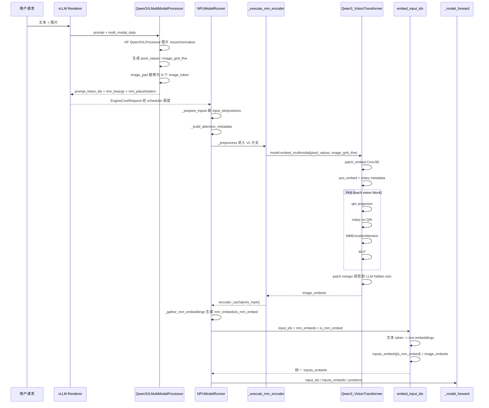

# Qwen3.5 VL 图文请求到统一 Embedding 序列的处理流程

本文以 `Qwen3_5ForConditionalGeneration` 的图文推理为例，梳理一个包含“一张图片 + 一段文字”的请求，从 vLLM 收到请求开始，到文本 token 与图片 token 合并为统一 `inputs_embeds` 序列为止的关键链路。

注意本地代码中的命名关系：

- `Qwen3_5ForConditionalGeneration` 定义在 `vllm/model_executor/models/qwen3_5.py`，继承 `Qwen3VLForConditionalGeneration`。
- 图像预处理、prompt placeholder、ViT、视觉 embedding 生成等前半段逻辑复用 `vllm/model_executor/models/qwen3_vl.py`。
- Qwen3.5 主要替换后续语言模型为 `Qwen3_5ForCausalLM`，并覆写了 `embed_input_ids()`，但合并逻辑仍然是先生成文本 embedding，再用视觉 embedding 覆盖 placeholder 位置。
- Ascend 侧最终在 `vllm-ascend/vllm_ascend/worker/model_runner_v1.py` 的 `_preprocess()` 和 `_model_forward()` 链路中调用这些 vLLM 模型方法。

## 总体数据形态

用户请求中一般是 OpenAI Chat 多模态格式，内容包含文本块和图片块。经过 vLLM renderer 与 multimodal processor 后，会变成一个 `EngineInput` / `EngineCoreRequest`，核心字段包括：

- `prompt_token_ids`：已经插入图片占位 token 的完整文本 token 序列。
- `mm_kwargs`：HF processor 处理后的图片张量，例如 `pixel_values`、`image_grid_thw`。
- `mm_placeholders`：图片 embedding 应该替换 prompt 中哪一段 token。
- `mm_hashes`：多模态输入的缓存 key。
- `mm_features`：进入 engine core 后的扁平多模态特征列表，包含 `data/modality/identifier/mm_position`。

对“一张图片 + 一段文字”，最终进入模型 forward 前，普通形态是：

```text
input_ids      = None  # 大多数 VL 模型不再直接消费 token ids
inputs_embeds  = [文本 embedding, 图片 patch embedding, 文本 embedding, ...]
positions      = M-RoPE positions
model_kwargs   = 多模态辅助 kwargs
```

`inputs_embeds` 是统一序列。视觉 token 不作为另一条支路传入语言模型，而是先由 ViT 变成和文本 hidden size 对齐的 embedding，再覆盖 prompt 中图片占位 token 对应的位置。

## 请求入口到 EngineCoreRequest

以 `/v1/chat/completions` 为例，请求入口在 vLLM OpenAI server：

```python
# vllm/vllm/entrypoints/openai/chat_completion/serving.py
async def _create_chat_completion(self, request, raw_request=None):
    result = await self.render_chat_request(request)
    conversation, engine_inputs = result
    ...
    generator = self.engine_client.generate(
        engine_input,
        sampling_params,
        sub_request_id,
        ...
    )
```

`render_chat_request()` 会委托 renderer 把 OpenAI Chat message 渲染成 vLLM engine 输入：

```python
# vllm/vllm/entrypoints/openai/chat_completion/serving.py
async def render_chat_request(self, request):
    ...
    return await self.openai_serving_render.render_chat(request)
```

renderer 的核心工作是：

1. `render_messages()`：把 chat message 和 chat template 渲染成 prompt。
2. `tokenize_prompts()`：生成初步 token ids。
3. `process_for_engine()`：如果存在 `multi_modal_data`，调用 `_process_multimodal()`。

```python
# vllm/vllm/renderers/base.py
def render_chat(...):
    rendered = [self.render_messages(conversation, chat_params)
                for conversation in conversations]
    tok_prompts = self.tokenize_prompts(dict_prompts, tok_params)
    eng_prompts = [
        self.process_for_engine(prompt, arrival_time, skip_mm_cache=skip_mm_cache)
        for prompt in tok_prompts
    ]
```

多模态 prompt 的处理入口：

```python
# vllm/vllm/renderers/base.py
def _process_multimodal(self, prompt, mm_data, mm_uuids,
                        mm_processor_kwargs, tokenization_kwargs, ...):
    mm_processor = self.get_mm_processor()
    mm_data_items = mm_processor.info.parse_mm_data(mm_data)
    ...
    mm_processor_inputs = MMProcessorInputs(
        prompt,
        mm_data_items,
        mm_uuid_items,
        hf_processor_mm_kwargs=mm_processor_kwargs or {},
        tokenization_kwargs=tokenization_kwargs or {},
    )
    mm_inputs = mm_processor.apply(mm_processor_inputs, mm_timing_ctx)
    return mm_inputs
```

Qwen3.5 注册的 processor 是 `Qwen3VLMultiModalProcessor`：

```python
# vllm/vllm/model_executor/models/qwen3_5.py
@MULTIMODAL_REGISTRY.register_processor(
    Qwen3VLMultiModalProcessor,
    info=Qwen3_5ProcessingInfo,
    dummy_inputs=Qwen3VLDummyInputsBuilder,
)
class Qwen3_5ForConditionalGeneration(Qwen3VLForConditionalGeneration, IsHybrid):
    ...
```

`BaseMultiModalProcessor.apply()` 的输出就是后续 engine 用的多模态输入：

```python
# vllm/vllm/multimodal/processing/processor.py
def apply(self, inputs, timing_ctx):
    prompt_ids, mm_info, is_update_applied = \
        self._cached_apply_hf_processor(inputs, timing_ctx)

    prompt_ids, mm_placeholders = self._maybe_apply_prompt_updates(
        mm_items=inputs.mm_data_items,
        prompt_ids=prompt_ids,
        mm_kwargs=mm_info.kwargs,
        mm_prompt_updates=mm_info.prompt_updates,
        is_update_applied=is_update_applied,
    )

    return mm_input(
        prompt_token_ids=prompt_ids,
        mm_kwargs=mm_info.kwargs,
        mm_hashes=mm_info.hashes,
        mm_placeholders=mm_placeholder_ranges,
    )
```

这里有两个关键点：

- HF processor 负责把原始图片 resize、normalize，并输出 `pixel_values`、`image_grid_thw` 等张量。
- prompt update 会把 `<|image_pad|>` 这类占位替换成与 ViT 输出 token 数一致的图片 token 序列。

Qwen3-VL 的图片占位 token 数由 `image_grid_thw` 和 `merge_size` 决定：

```python
# vllm/vllm/model_executor/models/qwen3_vl.py
def get_image_replacement_qwen3vl(item_idx: int):
    out_item = out_mm_kwargs["image"][item_idx]
    grid_thw = out_item["image_grid_thw"].data
    num_tokens = int(grid_thw.prod()) // merge_length
    return [hf_processor.image_token_id] * num_tokens
```

例如 `image_grid_thw = [1, 28, 28]`、`merge_size = 2`，则图片在 LLM 序列中占：

```text
1 * 28 * 28 / (2 * 2) = 196 个视觉 token
```

## EngineCoreRequest 到 Runner 状态

`InputProcessor.process_inputs()` 会把 renderer 输出的 `MultiModalInput` 转成 `EngineCoreRequest`。对于 multimodal 输入，它会把 `mm_kwargs/mm_placeholders/mm_hashes` 排序并扁平化为 `mm_features`：

```python
# vllm/vllm/v1/engine/input_processor.py
if decoder_inputs["type"] == "multimodal":
    decoder_mm_inputs = decoder_inputs["mm_kwargs"]
    decoder_mm_positions = decoder_inputs["mm_placeholders"]
    decoder_mm_hashes = decoder_inputs["mm_hashes"]

    sorted_mm_idxs = argsort_mm_positions(decoder_mm_positions)
    mm_features = []
    for modality, idx in sorted_mm_idxs:
        mm_features.append(
            MultiModalFeatureSpec(
                data=decoder_mm_inputs[modality][idx],
                modality=modality,
                identifier=self._get_mm_identifier(base_mm_hash, lora_request),
                mm_position=decoder_mm_positions[modality][idx],
                mm_hash=base_mm_hash,
            )
        )
```

之后 `EngineCoreRequest` 进入 engine core 和 scheduler。调度到某个 worker 后，`NPUModelRunner.execute_model()` 开始本轮 forward 准备：

```python
# vllm-ascend/vllm_ascend/worker/model_runner_v1.py
deferred_state_corrections_fn = self._update_states(scheduler_output)

(logits_indices,
 spec_decode_metadata,
 total_num_scheduled_tokens,
 num_scheduled_tokens_compressed_list) = self._prepare_inputs(
     scheduler_output,
     num_scheduled_tokens_np,
)

(attn_metadata, spec_decode_common_attn_metadata) = \
    self._build_attention_metadata(...)

(input_ids, inputs_embeds, positions, intermediate_tensors,
 model_kwargs, ec_connector_output) = self._preprocess(...)
```

`_prepare_inputs()` 只把本轮 token 按 scheduler 顺序排好：生成 `input_ids`、`positions`、`query_start_loc`、`slot_mapping`、`logits_indices` 等。此时图片位置仍然是图片占位 token id，真正的图片 embedding 还没有合并进去。

## `_preprocess` 中执行 ViT 与合并

Ascend 的 `_preprocess()` 在 PCP + MM 场景会先本地化 scheduler output，然后复用父类 `GPUModelRunner._preprocess()`：

```python
# vllm-ascend/vllm_ascend/worker/model_runner_v1.py
return super()._preprocess(
    scheduler_output, num_input_tokens, intermediate_tensors)
```

父类 VL 分支是合并的核心：

```python
# vllm/vllm/v1/worker/gpu_model_runner.py
if self.supports_mm_inputs and is_first_rank and not is_encoder_decoder:
    with self.maybe_get_ec_connector_output(
        scheduler_output,
        encoder_cache=self.encoder_cache,
    ) as ec_connector_output:
        self._execute_mm_encoder(scheduler_output)
        mm_embeds, is_mm_embed = self._gather_mm_embeddings(scheduler_output)

    inputs_embeds_scheduled = self.model.embed_input_ids(
        self.input_ids.gpu[:num_scheduled_tokens],
        multimodal_embeddings=mm_embeds,
        is_multimodal=is_mm_embed,
    )

    self.inputs_embeds.gpu[:num_scheduled_tokens].copy_(inputs_embeds_scheduled)
    input_ids, inputs_embeds = self._prepare_mm_inputs(num_input_tokens)
```

这段逻辑的先后顺序是：

1. `_execute_mm_encoder()`：执行图片 ViT，得到每张图片的视觉 embedding，写入 `encoder_cache`。
2. `_gather_mm_embeddings()`：根据当前调度窗口和 `mm_position`，取出本轮需要合并的视觉 embedding，并生成 `is_mm_embed` mask。
3. `model.embed_input_ids()`：文本 token 先走语言模型 embedding，再用视觉 embedding 覆盖图片占位位置。
4. `_prepare_mm_inputs()`：返回最终给 `_model_forward()` 的 `input_ids/inputs_embeds`。多数 VL 模型返回 `input_ids=None, inputs_embeds=...`。

## ViT 部分详细流程

### 1. `_execute_mm_encoder` 收集图片输入

worker 先从 scheduler output 找到本轮需要跑 encoder 的多模态输入：

```python
# vllm/vllm/v1/worker/gpu_model_runner.py
def _batch_mm_inputs_from_scheduler(self, scheduler_output):
    for req_id, encoder_input_ids in scheduled_encoder_inputs.items():
        req_state = self.requests[req_id]
        for mm_input_id in encoder_input_ids:
            mm_feature = req_state.mm_features[mm_input_id]
            mm_hashes.append(mm_feature.identifier)
            mm_kwargs.append((mm_feature.modality, mm_feature.data))
```

然后分组调用模型的 `embed_multimodal()`：

```python
# vllm/vllm/v1/worker/gpu_model_runner.py
for modality, num_items, mm_kwargs_batch in group_and_batch_mm_kwargs(...):
    batch_outputs = model.embed_multimodal(**mm_kwargs_batch)
    encoder_outputs.extend(batch_outputs)

for mm_hash, output in zip(mm_hashes, encoder_outputs):
    self.encoder_cache[mm_hash] = output
```

对一张图片，`mm_kwargs_batch` 里通常包含：

```text
pixel_values    # HF processor 输出的 patch/pixel 张量
image_grid_thw  # 形如 [T, H, W]，描述 ViT patch 网格
```

### 2. `embed_multimodal` 调用图片处理

Qwen3.5 继承 Qwen3-VL 的 `embed_multimodal()`：

```python
# vllm/vllm/model_executor/models/qwen3_vl.py
def embed_multimodal(self, **kwargs):
    mm_input_by_modality = self._parse_and_validate_multimodal_inputs(**kwargs)
    multimodal_embeddings = []

    for modality in mm_input_by_modality:
        multimodal_input = mm_input_by_modality[modality]
        if modality == "image":
            image_embeddings = self._process_image_input(multimodal_input)
            image_embeddings = self._postprocess_image_embeds_evs(
                image_embeddings, multimodal_input)
            multimodal_embeddings.extend(image_embeddings)

    return tuple(multimodal_embeddings)
```

`_parse_and_validate_image_input()` 识别两种输入：已经算好的 `image_embeds`，或者需要 ViT 处理的 `pixel_values`。正常图片请求走 `pixel_values`：

```python
# vllm/vllm/model_executor/models/qwen3_vl.py
def _parse_and_validate_image_input(self, **kwargs):
    pixel_values = kwargs.pop("pixel_values", None)
    image_embeds = kwargs.pop("image_embeds", None)
    image_grid_thw = kwargs.pop("image_grid_thw", None)

    if pixel_values is not None:
        return Qwen2_5_VLImagePixelInputs(
            type="pixel_values",
            pixel_values=pixel_values,
            image_grid_thw=image_grid_thw,
        )
```

### 3. `_process_image_input` 调用视觉塔

```python
# vllm/vllm/model_executor/models/qwen3_vl.py
def _process_image_input(self, image_input):
    grid_thw = image_input["image_grid_thw"]

    if image_input["type"] == "image_embeds":
        image_embeds = image_input["image_embeds"].type(self.visual.dtype)
    else:
        pixel_values = image_input["pixel_values"].type(self.visual.dtype)
        image_embeds = self.visual(pixel_values, grid_thw=grid_thw)

    merge_size = self.visual.spatial_merge_size
    sizes = (grid_thw.prod(-1) // merge_size // merge_size).tolist()
    return image_embeds.split(sizes)
```

这里 `self.visual` 是 Qwen3.5 初始化时构造的 `Qwen3_VisionTransformer`：

```python
# vllm/vllm/model_executor/models/qwen3_5.py
self.visual = Qwen3_VisionTransformer(
    config.vision_config,
    norm_eps=getattr(config, "rms_norm_eps", 1e-6),
    quant_config=quant_config,
    prefix=maybe_prefix(prefix, "visual"),
)
```

### 4. `Qwen3_VisionTransformer.forward`

ViT 的主干在 `qwen3_vl.py`：

```python
# vllm/vllm/model_executor/models/qwen3_vl.py
def forward(self, x, grid_thw, *, encoder_metadata=None):
    hidden_states = x.to(device=self.device, dtype=self.dtype, non_blocking=True)
    hidden_states = self.patch_embed(hidden_states)

    if encoder_metadata is None:
        encoder_metadata = self.prepare_encoder_metadata(grid_thw.tolist())

    pos_embeds = encoder_metadata["pos_embeds"]
    hidden_states = hidden_states + pos_embeds
    hidden_states = hidden_states.unsqueeze(1)

    deepstack_feature_lists = []
    for layer_num, blk in enumerate(self.blocks):
        hidden_states = blk(
            hidden_states,
            cu_seqlens=encoder_metadata["cu_seqlens"],
            rotary_pos_emb_cos=encoder_metadata["rotary_pos_emb_cos"],
            rotary_pos_emb_sin=encoder_metadata["rotary_pos_emb_sin"],
            max_seqlen=encoder_metadata["max_seqlen"],
            sequence_lengths=encoder_metadata.get("sequence_lengths"),
        )
        if layer_num in self.deepstack_visual_indexes:
            deepstack_feature = self.deepstack_merger_list[...](hidden_states)
            deepstack_feature_lists.append(deepstack_feature)

    hidden_states = self.merger(hidden_states)
    hidden_states = torch.cat([hidden_states] + deepstack_feature_lists, dim=1)
    return hidden_states
```

可以拆成 5 步：

1. `patch_embed`：把图片 patch 化并投影到 ViT hidden size。
2. `prepare_encoder_metadata`：根据 `grid_thw` 构造位置 embedding、rotary cos/sin、`cu_seqlens`、`max_seqlen`。
3. 多层 `Qwen3_VisionBlock`：每层做 LayerNorm + 视觉 attention + MLP。
4. `merger`：把 `spatial_merge_size^2` 个 patch 聚合成一个 LLM 视觉 token，并投影到语言模型 hidden size。
5. deepstack 可选：中间层视觉特征也会通过 deepstack merger 生成附加特征。

### 5. Patch embedding

```python
# vllm/vllm/model_executor/models/qwen3_vl.py
class Qwen3_VisionPatchEmbed(nn.Module):
    def forward(self, x):
        L, C = x.shape
        x = x.view(L, -1, self.temporal_patch_size,
                   self.patch_size, self.patch_size)
        x = self.proj(x).view(L, self.hidden_size)
        return x
```

这里的 `self.proj` 是 3D convolution，kernel 和 stride 都是 `(temporal_patch_size, patch_size, patch_size)`。对单图，时间维通常可以理解为 1 组或按 processor 展开的 temporal patch。

### 6. 视觉位置和 attention metadata

`prepare_encoder_metadata()` 做三件关键事情：

```python
# vllm/vllm/model_executor/models/qwen3_vl.py
metadata["pos_embeds"] = self.fast_pos_embed_interpolate(grid_thw_list)
rotary_cos, rotary_sin = self.rot_pos_emb(grid_thw_list)
metadata["rotary_pos_emb_cos"] = rotary_cos
metadata["rotary_pos_emb_sin"] = rotary_sin

patches_per_frame = grid_thw_np[:, 1] * grid_thw_np[:, 2]
cu_seqlens = np.repeat(patches_per_frame, grid_thw_np[:, 0]).cumsum(...)
metadata["cu_seqlens"] = MMEncoderAttention.maybe_recompute_cu_seqlens(...)
metadata["max_seqlen"] = torch.tensor(max_seqlen_val, dtype=torch.int32)
```

- `pos_embeds` 是绝对/插值位置 embedding，直接加到 patch embedding 上。
- `rotary_pos_emb_cos/sin` 用于视觉 attention 中的 Q/K rotary。
- `cu_seqlens/max_seqlen/sequence_lengths` 用于多图片或视频 batch 中的 varlen attention。

Ascend patch 对位置插值做了替换：

```python
# vllm-ascend/vllm_ascend/patch/worker/patch_qwen3vl.py
def _fast_pos_embed_interpolate(self, grid_thw):
    outputs = []
    for t, h, w in grid_thw:
        outputs.append(
            pos_embed_interpolate_native(
                self.pos_embed.weight, t, h, w,
                self.num_grid_per_side,
                self.spatial_merge_size,
                self.dtype,
            )
        )
    return torch.cat(outputs, dim=0)

Qwen3_VisionTransformer.fast_pos_embed_interpolate = \
    _fast_pos_embed_interpolate
```

### 7. Vision block 与 attention 计算

每个 `Qwen3_VisionBlock` 是标准残差结构：

```python
# vllm/vllm/model_executor/models/qwen3_vl.py
def forward(self, x, cu_seqlens, rotary_pos_emb_cos,
            rotary_pos_emb_sin, max_seqlen, sequence_lengths):
    x = x + self.attn(
        self.norm1(x),
        cu_seqlens=cu_seqlens,
        rotary_pos_emb_cos=rotary_pos_emb_cos,
        rotary_pos_emb_sin=rotary_pos_emb_sin,
        max_seqlen=max_seqlen,
        sequence_lengths=sequence_lengths,
    )
    x = x + self.mlp(self.norm2(x))
    return x
```

`self.attn` 使用 `Qwen2_5_VisionAttention`，Qwen3-VL 复用该 attention 实现：

```python
# vllm/vllm/model_executor/models/qwen2_5_vl.py
def forward(self, x, cu_seqlens, rotary_pos_emb_cos,
            rotary_pos_emb_sin, max_seqlen, sequence_lengths):
    x, _ = self.qkv(x)
    qkv = einops.rearrange(
        x, "s b (three head head_dim) -> b s three head head_dim",
        three=3, head=self.num_attention_heads_per_partition,
    )

    qk, v = qkv[:, :, :2], qkv[:, :, 2]
    qk_rotated = self.apply_rotary_emb(
        qk_reshaped, rotary_pos_emb_cos, rotary_pos_emb_sin)
    q, k = qk_rotated.unbind(dim=0)

    context_layer = self.attn(
        query=q,
        key=k,
        value=v,
        cu_seqlens=cu_seqlens,
        max_seqlen=max_seqlen,
        sequence_lengths=sequence_lengths,
    )

    context_layer = einops.rearrange(
        context_layer, "b s h d -> s b (h d)", b=batch_size)
    output, _ = self.proj(context_layer)
    return output
```

attention 中真正的 Q/K/V attention 由 `MMEncoderAttention` 执行，它会根据后端选择合适的 ViT encoder attention kernel。

### 8. Merger 输出 LLM 视觉 token

```python
# vllm/vllm/model_executor/models/qwen3_vl.py
class Qwen3_VisionPatchMerger(nn.Module):
    def forward(self, x):
        if self.use_postshuffle_norm:
            x = self.norm(x.view(-1, self.hidden_size))
        else:
            x = self.norm(x).view(-1, self.hidden_size)

        x_parallel, _ = self.linear_fc1(x)
        x_parallel = self.act_fn(x_parallel)
        out, _ = self.linear_fc2(x_parallel)
        return out
```

`self.hidden_size = context_dim * spatial_merge_size^2`。也就是说，每 `spatial_merge_size^2` 个 ViT patch 会拼成一个视觉 token，再经过 MLP 投影到语言模型 hidden size。这个输出就是后面要合并进 `inputs_embeds` 的图片 embedding。

## 文本和图片合并为统一 `inputs_embeds`

`_gather_mm_embeddings()` 根据当前 batch 的 token 窗口从 `encoder_cache` 取出视觉 embedding，同时生成 `is_mm_embed`：

```python
# vllm/vllm/v1/worker/gpu_model_runner.py
lo, hi = get_mm_features_in_window(
    mm_features,
    start=num_computed_tokens,
    end=num_computed_tokens + num_scheduled_tokens,
)

for i in range(lo, hi):
    mm_feature = mm_features[i]
    pos_info = mm_feature.mm_position
    encoder_output = self.encoder_cache[mm_feature.identifier]
    ...
    mm_embeds_req.append(mm_embeds_item)
    is_mm_embed[req_start_pos + start_idx:req_start_pos + end_idx] = True
```

之后调用 Qwen3.5 的 `embed_input_ids()`：

```python
# vllm/vllm/model_executor/models/qwen3_5.py
def embed_input_ids(self, input_ids, multimodal_embeddings=None,
                    *, is_multimodal=None):
    inputs_embeds = self._embed_text_input_ids(
        input_ids,
        self.language_model.embed_input_ids,
        is_multimodal=is_multimodal,
    )

    if multimodal_embeddings is None or len(multimodal_embeddings) == 0:
        return inputs_embeds

    inputs_embeds = _merge_multimodal_embeddings(
        inputs_embeds=inputs_embeds,
        multimodal_embeddings=multimodal_embeddings,
        is_multimodal=is_multimodal,
    )
    return inputs_embeds
```

底层合并函数就是按 mask 覆盖：

```python
# vllm/vllm/model_executor/models/utils.py
def _merge_multimodal_embeddings(inputs_embeds,
                                 multimodal_embeddings,
                                 is_multimodal):
    mm_embeds_flat = _flatten_embeddings(multimodal_embeddings)
    inputs_embeds[is_multimodal] = mm_embeds_flat.to(dtype=inputs_embeds.dtype)
    return inputs_embeds
```

一个简化例子：

```text
prompt token 序列:
[BOS, "请", "描述", image_token x 196, "这张图"]

_prepare_inputs 后:
input_ids = [T_BOS, T_请, T_描述, T_image, ..., T_image, T_这张图]

_execute_mm_encoder 后:
encoder_cache["img_hash"] = image_embeds  # shape: [196, hidden_size]

_gather_mm_embeddings 后:
mm_embeds = [image_embeds]
is_mm_embed = [False, False, False, True x 196, False]

embed_input_ids 后:
inputs_embeds[0]      = Emb(T_BOS)
inputs_embeds[1]      = Emb(T_请)
inputs_embeds[2]      = Emb(T_描述)
inputs_embeds[3:199]  = image_embeds[0:196]
inputs_embeds[199]    = Emb(T_这张图)
```

最后 `_prepare_mm_inputs()` 返回统一 embedding 序列：

```python
# vllm/vllm/v1/worker/gpu_model_runner.py
def _prepare_mm_inputs(self, num_tokens):
    if self.model.requires_raw_input_tokens:
        input_ids = self.input_ids.gpu[:num_tokens]
    else:
        input_ids = None
    inputs_embeds = self.inputs_embeds.gpu[:num_tokens]
    return input_ids, inputs_embeds
```

## `_model_forward` 前后的完整调用栈

下面调用栈以 OpenAI Chat 请求为入口，并包含 vLLM 与 vLLM Ascend 两个仓的文件路径。`_model_forward()` 之前详细展开，之后粗粒度表示。

```text
HTTP POST /v1/chat/completions
  └─ vllm/vllm/entrypoints/openai/chat_completion/api_router.py
     └─ create_chat_completion(...)
        └─ vllm/vllm/entrypoints/openai/chat_completion/serving.py
           └─ OpenAIServingChat._create_chat_completion(...)
              ├─ render_chat_request(...)
              │  └─ openai_serving_render.render_chat(...)
              │     └─ vllm/vllm/renderers/base.py
              │        ├─ BaseRenderer.render_chat(...)
              │        │  ├─ render_messages(...)
              │        │  ├─ tokenize_prompts(...)
              │        │  └─ process_for_engine(...)
              │        │     └─ _process_tokens(...)
              │        │        └─ _process_multimodal(...)
              │        │           ├─ get_mm_processor()
              │        │           │  └─ Qwen3VLMultiModalProcessor
              │        │           ├─ info.parse_mm_data(...)
              │        │           └─ mm_processor.apply(...)
              │        │              └─ vllm/vllm/multimodal/processing/processor.py
              │        │                 ├─ _cached_apply_hf_processor(...)
              │        │                 │  └─ _apply_hf_processor(...)
              │        │                 │     ├─ _apply_hf_processor_main(...)
              │        │                 │     │  └─ Qwen3VLMultiModalProcessor._call_hf_processor(...)
              │        │                 │     │     └─ HF Qwen3VLProcessor
              │        │                 │     │        ├─ tokenize prompt
              │        │                 │     │        └─ preprocess image -> pixel_values/image_grid_thw
              │        │                 │     ├─ MultiModalKwargsItems.from_hf_inputs(...)
              │        │                 │     ├─ inputs.get_mm_hashes(...)
              │        │                 │     └─ Qwen3VLMultiModalProcessor._get_prompt_updates(...)
              │        │                 │        └─ get_image_replacement_qwen3vl(...)
              │        │                 ├─ _maybe_apply_prompt_updates(...)
              │        │                 └─ return MultiModalInput(
              │        │                       prompt_token_ids,
              │        │                       mm_kwargs,
              │        │                       mm_hashes,
              │        │                       mm_placeholders)
              │        └─ returns engine_inputs
              └─ engine_client.generate(...)
                 └─ vllm/vllm/v1/engine/input_processor.py
                    └─ InputProcessor.process_inputs(...)
                       ├─ split_enc_dec_input(...)
                       ├─ argsort_mm_positions(...)
                       ├─ build MultiModalFeatureSpec(...)
                       └─ return EngineCoreRequest(..., mm_features=...)

EngineCore scheduling
  └─ scheduler 产生 SchedulerOutput
     └─ vllm-ascend/vllm_ascend/worker/model_runner_v1.py
        └─ NPUModelRunner.execute_model(...)
           ├─ _update_states(scheduler_output)
           │  └─ 写入 self.requests / self.input_batch / req.mm_features
           ├─ _prepare_inputs(...)
           │  ├─ 展开 req_indices
           │  ├─ 计算 positions/query_start_loc/seq_lens
           │  ├─ 从 token_ids_cpu_tensor 取本轮 input_ids
           │  ├─ Qwen3.5 VL: _calc_mrope_positions(...)
           │  └─ 准备 slot_mapping/logits_indices
           ├─ _build_attention_metadata(...)
           ├─ _preprocess(...)
           │  └─ vllm/vllm/v1/worker/gpu_model_runner.py
           │     └─ GPUModelRunner._preprocess(...)
           │        ├─ _execute_mm_encoder(...)
           │        │  ├─ _batch_mm_inputs_from_scheduler(...)
           │        │  │  └─ 从 req.mm_features 取 image mm_kwargs
           │        │  ├─ group_and_batch_mm_kwargs(...)
           │        │  └─ model.embed_multimodal(...)
           │        │     └─ vllm/vllm/model_executor/models/qwen3_vl.py
           │        │        ├─ Qwen3VLForConditionalGeneration.embed_multimodal(...)
           │        │        ├─ _parse_and_validate_multimodal_inputs(...)
           │        │        ├─ _parse_and_validate_image_input(...)
           │        │        ├─ _process_image_input(...)
           │        │        │  └─ self.visual(pixel_values, grid_thw)
           │        │        │     └─ Qwen3_VisionTransformer.forward(...)
           │        │        │        ├─ Qwen3_VisionPatchEmbed.forward(...)
           │        │        │        ├─ prepare_encoder_metadata(...)
           │        │        │        │  ├─ fast_pos_embed_interpolate(...)
           │        │        │        │  │  └─ Ascend patch:
           │        │        │        │  │     vllm-ascend/vllm_ascend/patch/worker/patch_qwen3vl.py
           │        │        │        │  │     └─ pos_embed_interpolate_native(...)
           │        │        │        │  ├─ rot_pos_emb(...)
           │        │        │        │  ├─ MMEncoderAttention.compute_max_seqlen(...)
           │        │        │        │  └─ MMEncoderAttention.maybe_recompute_cu_seqlens(...)
           │        │        │        ├─ for each Qwen3_VisionBlock:
           │        │        │        │  ├─ norm1
           │        │        │        │  ├─ Qwen2_5_VisionAttention.forward(...)
           │        │        │        │  │  ├─ qkv projection
           │        │        │        │  │  ├─ apply_rotary_emb(q, k)
           │        │        │        │  │  ├─ MMEncoderAttention(...)
           │        │        │        │  │  └─ output projection
           │        │        │        │  ├─ norm2
           │        │        │        │  └─ Qwen3_VisionMLP.forward(...)
           │        │        │        ├─ Qwen3_VisionPatchMerger.forward(...)
           │        │        │        └─ return image_embeds.split(...)
           │        │  └─ encoder_cache[mm_hash] = image_embeds
           │        ├─ _gather_mm_embeddings(...)
           │        │  ├─ get_mm_features_in_window(...)
           │        │  ├─ encoder_cache[mm_hash]
           │        │  └─ build is_mm_embed mask
           │        ├─ model.embed_input_ids(...)
           │        │  └─ vllm/vllm/model_executor/models/qwen3_5.py
           │        │     └─ Qwen3_5ForConditionalGeneration.embed_input_ids(...)
           │        │        ├─ _embed_text_input_ids(...)
           │        │        │  └─ language_model.embed_input_ids(...)
           │        │        └─ _merge_multimodal_embeddings(...)
           │        │           └─ inputs_embeds[is_multimodal] = image_embeds
           │        ├─ self.inputs_embeds.gpu[:num_scheduled_tokens].copy_(...)
           │        ├─ _prepare_mm_inputs(...)
           │        └─ choose positions = mrope_positions.gpu[:, :num_input_tokens]
           ├─ update_cos_sin(positions)
           ├─ set_ascend_forward_context(...)
           └─ _model_forward(num_tokens_padded, input_ids, positions,
                             intermediate_tensors, inputs_embeds, **model_kwargs)

_model_forward 之后
  ├─ Qwen3_5ForConditionalGeneration.forward(...)
  │  └─ language_model.model(..., inputs_embeds=inputs_embeds)
  ├─ hidden_states
  ├─ sample_hidden_states = hidden_states[logits_indices]
  ├─ compute_logits(...)
  ├─ 保存 ExecuteModelState
  └─ sample_tokens(...) 完成采样、bookkeeping、可选 speculative draft
```

## ViT 到合并的时序图



## 关键结论

- Qwen3.5 的图文前处理和 ViT 路径复用 Qwen3-VL；`qwen3_5.py` 主要替换语言模型，并保留同一套多模态 processor。
- 图片 token 数不是随意设定的，而是由 `image_grid_thw.prod() / spatial_merge_size^2` 决定；prompt 中必须有同等数量的 image placeholder。
- ViT 输出先经过 `Qwen3_VisionPatchMerger` 投影到语言模型 hidden size，才可以替换文本 embedding 序列中的图片 placeholder。
- 合并发生在 `_preprocess()` 中，位置在 `_prepare_inputs()` 和 `_model_forward()` 之间。
- 最终语言模型看到的是一条连续的 `inputs_embeds` 序列，里面既有文本 embedding，也有图片 embedding。
